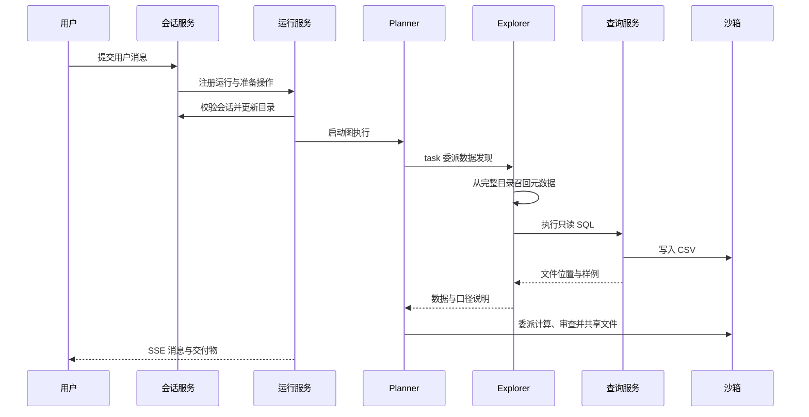

# 00. DataAgent Mini：项目能力与模块协作

DataAgent Mini 将自然语言问题转化为数据发现、只读查询、计算、审查和文件交付。模型负责选择分析步骤，应用管理身份、执行状态和资源，Doris 执行业务数据权限检查。

## 1. 提供哪些功能

```text
DataAgent Mini：数据分析与协作
├── 身份选择（用户）
│   ├── 选择预定义用户，切换会话列表
│   └── 使用所选用户角色对应的 Doris 查询账号
├── 业务数据准备（开发者）
│   ├── 初始化并生成 Doris 示例数据
│   ├── 初始化用户、角色与查询凭据
│   └── 导入业务目录，构建语义和字段取值索引
├── 对话分析（用户、Planner）
│   ├── 新建会话、发送消息、查看历史和运行状态
│   ├── 委派 Explorer 召回上下文并执行只读 SQL
│   ├── 委派 Analyst 分析数据并制作报告
│   ├── 委派 Reviewer 复核数据和交付物
│   └── 流式展示结果，提供文件预览和下载
├── 执行控制（用户、应用）
│   ├── 订阅后台运行、主动停止和恢复中断回合
│   ├── 生成会话标题，清理草稿和待删除会话
│   └── 查询权限不足时由 Agent 结束当前任务并说明原因
└── 隔离与资源管理（应用）
    ├── 按用户隔离容器和数据卷，按会话隔离文件身份
    ├── 在禁网沙箱中运行分析代码
    ├── 回收空闲容器，保留数据卷并恢复历史附件访问
    └── 管理客户端、日志、错误响应和跨进程资源租约
```

## 2. 如何使用

### 2.1 运行组成

| 进程或服务 | 用途 |
| --- | --- |
| FastAPI | 用户、聊天、运行控制、附件和 SSE 接口 |
| React 前端 | 选择用户、聊天、查看任务与交付物 |
| PostgreSQL | 用户和查询凭据、元数据目录、会话及 Checkpoint |
| Doris | 业务数据、查询账号和实际授权 |
| Elasticsearch 与向量服务 | 全文检索、向量索引与语义召回 |
| Redis | 元数据导入互斥、沙箱操作租约与维护协调 |
| Docker | 基础服务、分析容器和持久数据卷 |

Web 采用单进程运行，标题和会话清理使用该进程的异步任务。

### 2.2 开发时调用模块

| 模块     | 接收什么                   | 负责什么                          | 交付什么                     |
| -------- | -------------------------- | --------------------------------- | ---------------------------- |
| 公共模块 | 配置与生命周期要求         | 连接、配置、日志、异常、ORM 基础  | 可复用基础设施               |
| 身份     | 应用用户 ID                | 解析用户角色和查询身份           | 用户信息和查询凭据       |
| 元数据   | 导入配置或检索词           | 目录、索引、水位和语义召回        | 业务表字段与指标上下文       |
| 查询     | 用户、会话、SQL、查询目的  | 只读检查、流式执行、结果写入      | CSV 位置与结果摘要           |
| 多智能体 | 用户消息与会话             | Agent 装配、运行控制、消息投影    | 流式消息与交付物引用         |
| 沙箱     | 用户、会话及文件或命令操作 | 工作区、进程、容器和资源协调      | 文件内容、产物位置和执行结果 |

服务层表达业务步骤，仓储表达外部数据访问，模型表达输入、输出和持久化结构。路由负责请求解析和传输，不承担 Agent 图的运行循环；工具负责将 Agent 上下文转换为服务调用，不自行管理数据库连接或 Docker 资源。


## 3. 模块如何协作

### 3.1 一次分析



Planner 可以多次调用专业 Agent。调用顺序由模型结合任务决定，代码装配定义的是可用能力，不是固定的四阶段流水线。

Doris 查询和模型请求由应用进程发起。沙箱负责运行分析代码，其网络默认关闭；业务查询通过受控查询工具完成，CSV 写入当前会话工作区后供其他 Agent 使用。

### 3.2 元数据准备

导入脚本先读取配置并校验源表，再替换元数据目录和检索索引。字段和指标的名称、描述、别名参与语义检索；字段取值单独建立全文索引。

全量导入影响整个目录和三个索引。增量只同步配置了水位的字段取值，不刷新字段说明、指标定义或表结构。二者共用同一个导入锁，避免同时修改目录及索引。

在线召回从 PostgreSQL 读取完整目录，再查询 Elasticsearch，不读取用户角色授权。索引命中必须能映射到当前目录中的资源，才能进入返回结果；这项检查用于排除陈旧索引，不表示查询授权。

### 3.3 权限与资源归属

前端用 X-User-ID 选择应用用户。该机制用于选择会话归属和查询身份，本身不能证明操作者身份，因此当前运行环境需要信任使用者。

元数据召回不按用户角色过滤，目录中的表、字段、指标、样例及已索引取值可能出现在任意用户的召回结果中。SQL 使用对应角色的独立查询账号执行，由 Doris 判定权限；沙箱按用户和会话隔离计算文件。召回成功不代表可以读取对应业务数据。

Doris 拒绝查询权限时，工具返回 `permission_denied`，不通过异常中止整个图运行。Explorer 和 Planner 按提示词停止当前任务并告知用户，用户仍可在同一会话发起新的独立问题。

### 3.4 事务与失败恢复

| 操作           | 原子范围               | 跨系统部分                 | 失败后的处理                    |
| -------------- | ---------------------- | -------------------------- | ------------------------------- |
| 替换元数据目录 | 单次 PostgreSQL 事务   | ES 重建与向量请求          | 修复原因后重跑全量              |
| 增量取值同步   | 单字段水位提交         | ES 文档写入与刷新          | 保留旧水位，重跑覆盖            |
| 提交对话       | 会话记录更新           | 后台任务与模型调用         | 通过 Run 状态和 Checkpoint 判断 |
| 生成查询产物   | 无跨系统事务           | Doris 读取与沙箱写入       | 失败不返回成功结果              |
| 删除会话       | 删除标记或目录记录变更 | 任务取消、Checkpoint、沙箱 | 持久删除标记驱动补偿            |

不要把持有一个数据库 Session 理解成整个操作具备事务性。事务只能约束该数据库内的修改；外部系统的执行顺序、幂等能力和补偿机制决定整体失败语义。

## 4. 目录、数据和运行资源

### 4.1 目录组织

| 目录或文件 | 职责 |
| --- | --- |
| `app/shared/` | 配置、客户端、ORM 基础、错误和日志 |
| `app/identity/` | 用户选择和查询凭据 |
| `app/metadata/` | 目录导入、索引同步和召回 |
| `app/query/` | SQL 校验、执行和 CSV 交付 |
| `app/assistant/` | 会话、Agent、运行控制和消息投影 |
| `app/sandbox/` | 文件、命令、容器和操作协调 |
| `app/runtime.py` | Web 应用资源装配和释放 |
| `resources/assistant/` | 角色提示词与 Analyst 技能 |
| `scripts/`、`dbmock/` | 初始化、导入与示例数据生成 |
| `web/` | 页面、消息渲染与 API 调用 |

### 4.2 状态归属

| 状态                     | 保存位置              | 生命周期             | 所有者       |
| ------------------------ | --------------------- | -------------------- | ------------ |
| 应用用户及角色关联       | 身份数据库            | 跨进程重启           | 身份模块     |
| 加密查询凭据             | 身份数据库            | 跨进程重启           | 身份模块     |
| 元数据目录和取值水位     | 元数据数据库          | 全量替换、增量更新   | 元数据模块   |
| 检索文档                 | Elasticsearch         | 随导入更新           | 元数据模块   |
| 会话标题、草稿和删除标记 | 会话数据库            | 会话生命周期         | 会话服务     |
| Planner 消息及待执行节点 | PostgreSQL Checkpoint | 跨运行、跨重启       | LangGraph    |
| 活跃 Run 和事件缓冲      | Web 进程内存          | 单次启动或恢复       | 运行服务     |
| 查询与分析文件           | Docker 数据卷         | 直到会话资源删除     | 沙箱模块     |
| 导入锁与沙箱协调状态     | Redis                 | 锁、操作或运行时租约 | 各模块协调器 |

Conversation 是业务会话，Turn 是一次用户交互，Run 是一次启动或恢复产生的执行实例。一个 Conversation 可以有多个 Turn；某个 Turn 中断后可以通过另一个 Run 恢复。Checkpoint 描述图状态，不能直接替代进程内的任务对象。

### 4.3 资源生命周期

应用启动构造一份 WebResources，创建数据库、检索、向量服务、Checkpoint、沙箱、Agent 和业务服务，并挂到应用状态。请求依赖从中取得所需对象。

连接资源创建后立即登记关闭动作。启动继续完成 Checkpoint 初始化、沙箱初始化、模型资源初始化和 ORM 建表，最后启动会话后台清理。初始化中途失败也会进入已登记资源的清理流程。

退出时先使正在使用资源的任务停止，再关闭其底层客户端。AsyncExitStack 按登记的相反顺序执行清理，避免业务任务还在运行时先销毁连接池。异常清理本身仍可能失败，失败需要通过日志定位。

独立脚本管理自己的资源作用域。元数据导入不依赖 Web 已经启动，也不会复用 Web 进程中的数据库对象。

### 4.4 并发与部署

Web 使用单进程异步事件循环。模型、数据库和网络调用在等待时让出执行权；Docker SDK 等同步操作通过沙箱内部线程执行。异步任务解决并发等待，但不自动保证同一资源只能被一个任务修改。

同一会话的重复启动由进程内 Run 注册表控制；会话资源删除由本地锁串行协调；元数据导入由 Redis 租约锁串行化；沙箱使用 Redis 维护跨运行时的操作租约和维护窗口。

这些机制各自保护不同资源。沙箱具备跨进程协调，不代表整个应用可以直接增加多个 Web worker：运行任务、取消入口和 SSE 事件缓冲仍属于单进程。
