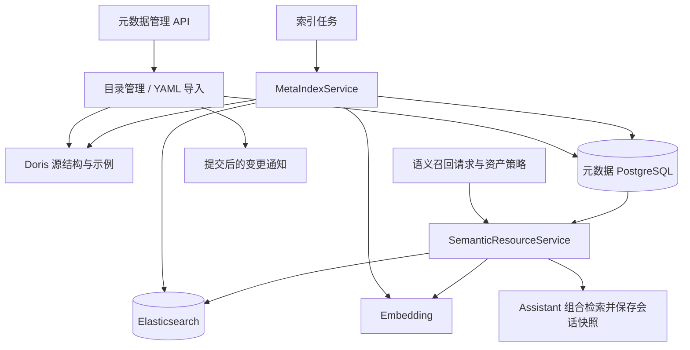

# 03. Metadata：业务目录、索引同步与语义召回

Metadata 维护表、字段和指标的业务定义，将目录及字段取值构建为检索索引。PostgreSQL 保存目录和同步事实，Elasticsearch 保存可重建的检索文档。

## 1. 提供哪些功能

```text
Metadata：业务目录与语义召回
├── 表目录管理（平台管理员）
│   ├── 查询业务表目录与 Doris 来源表
│   ├── 创建或修改表的业务说明与 fact/dim 角色
│   ├── 读取源表主键信息
│   ├── 配置字段取值同步使用的游标列
│   └── 批量删除表目录并处理依赖和索引清理
├── 字段目录管理（平台管理员）
│   ├── 查询表下字段及其源类型、示例值
│   ├── 创建或修改字段说明与别名
│   ├── 设置或清除外键引用
│   ├── 开启或关闭字段取值索引
│   └── 批量删除字段并检查外键和指标依赖
├── 指标目录管理（平台管理员）
│   ├── 查询指标及其业务口径
│   ├── 创建或修改指标说明与别名
│   ├── 维护指标依赖的表字段
│   └── 批量删除指标及其索引
├── YAML 导入导出（平台管理员）
│   ├── 解析并检查上传文件的结构与资源依赖
│   ├── 预检表、字段、指标的新增、修改和删除清单
│   ├── 按 merge 模式合并目录
│   ├── 按 replace 模式替换目录
│   ├── 提交后台正式导入并返回任务标识
│   └── 导出当前表、字段、指标及依赖关系
├── 语义索引同步（管理员、后台任务）
│   ├── 同步指定表内全部字段的语义索引
│   ├── 同步指定字段的名称、别名和说明
│   ├── 同步指定指标的名称、别名和业务口径
│   ├── 差量更新全文与向量文档，复用未变化文本的向量
│   └── 按目录版本确认同步结果，提供索引版本与滞后状态
├── 字段取值同步（管理员、定时任务）
│   ├── 全量读取启用字段的取值并清理旧值
│   ├── 按配置游标与已提交水位增量补充取值
│   ├── 按表或指定字段提交同步任务
│   ├── 定时安排字段取值同步
│   └── 记录同步状态、水位、时间和失败原因
├── 语义资源检索（Assistant）
│   ├── 按检索词选择字段、指标和取值资源
│   ├── 按当前资产策略过滤目录与搜索范围
│   ├── 融合字段和指标的全文、向量检索结果
│   ├── 通过全文检索查找字段实际取值
│   ├── 补充指标依赖字段、已授权主键和外键上下文
│   ├── 返回命中依据、索引状态、部分失败与截断信息
│   └── 按当前权限过滤已有召回结果和保存快照
└── 目录快照与变更通知（Query、Workflows）
    ├── 提供 SQL 依赖解析使用的表字段快照
    ├── 读取指定表和字段的当前元数据版本
    └── 目录提交后通知工作流失效关联经验并提交语义索引
```

## 2. 如何使用

### 2.1 页面与 HTTP 入口

管理中心的“元数据管理”提供目录维护、YAML 导入导出和索引同步。全部管理操作要求平台管理员身份，路径前缀为 `/api/v1/meta`。

| 操作 | HTTP 入口 |
| --- | --- |
| 导入元数据 YAML，支持预检查 | `POST /api/v1/meta/import` |
| 导出元数据 YAML | `GET /api/v1/meta/export` |
| 查询表目录 | `GET /api/v1/meta/tables` |
| 查询 Doris 来源表 | `GET /api/v1/meta/source-tables` |
| 查询表的字段目录 | `GET /api/v1/meta/tables/{t_name}/columns` |
| 查询指标目录 | `GET /api/v1/meta/metrics` |
| 创建或更新表元数据 | `PUT /api/v1/meta/tables/{t_name}` |
| 创建或更新字段元数据 | `PUT /api/v1/meta/tables/{t_name}/columns/{c_name}` |
| 创建或更新指标元数据 | `PUT /api/v1/meta/metrics/{metric_name}` |
| 批量删除表元数据 | `POST /api/v1/meta/tables/batch-delete` |
| 批量删除字段元数据 | `POST /api/v1/meta/columns/batch-delete` |
| 批量删除指标元数据 | `POST /api/v1/meta/metrics/batch-delete` |
| 提交表内字段语义索引同步 | `POST /api/v1/meta/tables/sync` |
| 提交表取值索引同步 | `POST /api/v1/meta/tables/sync-values` |
| 提交字段语义索引同步 | `POST /api/v1/meta/columns/sync` |
| 提交字段取值索引同步 | `POST /api/v1/meta/columns/sync-values` |
| 提交指标语义索引同步 | `POST /api/v1/meta/metrics/sync` |

首次接入步骤：

1. 预检 `conf/meta_config.yaml`，确认变更清单。
2. 提交正式导入，通过 `GET /api/v1/tasks/{task_id}` 查看后台结果。
3. 等待字段和指标语义索引同步完成。
4. 对启用取值索引的字段执行首次全量同步，并查询对应任务结果。

### 2.2 逐项维护业务目录

管理员先从来源表列表确认 Doris 中实际存在的表，再维护应用目录。表和字段的物理类型、主键及示例读取依赖 Doris 管理连接；业务说明由管理员填写。

| 对象 | 请求中提供什么 | 保存后得到什么 |
| --- | --- | --- |
| 表 | 路径指定表名；请求体提供 `role`、`description`，可选 `value_index_cursor_column` | 表目录和源主键信息，成功返回 204 |
| 字段 | 路径指定表和字段；请求体提供 `description`、`index_values`，可选别名和成对外键引用 | 字段目录、源类型与示例，返回可选 `semantic_index_task_id` |
| 指标 | 路径指定指标名；请求体提供 `description`，可选别名与 `relevant_columns` | 指标口径和字段依赖，返回可选 `semantic_index_task_id` |

例如，已存在 `orders` 表及 `region` 字段时，向 `PUT /api/v1/meta/tables/orders/columns/region` 提交：

```json
{
  "description": "订单所属销售地区",
  "alias": ["区域"],
  "index_values": true
}
```

这个操作保存字段说明并按变更提交语义索引任务。`index_values=true` 表示允许为字段建立取值索引，具体取值同步通过同步入口或定时任务执行。查询字段列表可看到 `meta_version`、`index_version` 和 `value_index_state`。

| 后续操作 | 请求内容与注意事项 |
| --- | --- |
| 删除表 | `tables` 名称列表 |
| 删除字段 | `columns` 对象列表，每项为 `t_name`、`c_name` |
| 删除指标 | `metrics` 名称列表 |
| 修改字段引用 | 同时提供 `reference_t_name` 和 `reference_c_name` |

删除前需处理仍在使用目标字段的外键和指标依赖。目录提交后的经验失效或任务投递可能单独失败；遇到异常先重新读取目录，确认实际保存结果。

### 2.3 批量导入和导出 YAML

适用于首次接入或批量维护一个业务域。上传内容描述业务目录，涉及的表和字段需已存在于配置的 Doris 数据库中。

下面是一个结构示例，使用前将名称替换为实际源表字段：

```yaml
tables:
  - name: orders
    role: fact
    description: 订单明细，每个订单一行
    columns:
      - name: region
        description: 订单所属销售地区
        alias: [区域]
        index_values: true
      - name: amount
        description: 订单金额
        index_values: false
metrics:
  - name: sales_amount
    description: 销售额，按订单金额汇总
    alias: [销售收入]
    relevant_columns:
      - t_name: orders
        c_name: amount
```

导入调用：

| 参数 | 位置 | 用途 |
| --- | --- | --- |
| `file` | multipart 文件字段 | UTF-8 YAML 文件 |
| `mode` | 查询参数 | `merge` 保留文件外的资源；`replace` 以文件给出的最终目录为准 |
| `dry_run` | 查询参数 | true 返回预检清单，false 提交后台导入；默认 false |

1. 上传文件到 `/api/v1/meta/import?mode=merge&dry_run=true`。
2. 检查 `tables`、`columns`、`metrics` 下的新增、修改、删除数量及键列表。
3. 使用同一份文件和模式，以 `dry_run=false` 提交正式导入。
4. 保存返回的 `task_id`，查询后台执行结果，再读取目录和索引状态。

预检会读取当前目录和源结构；正式执行时重新检查最终依赖关系。两次调用间目录或源数据可能变化，预检成功不保证后续任务必然成功。

`GET /api/v1/meta/export` 返回名为 `metadata.yaml` 的 YAML 附件，包含当前表、字段、指标和依赖关系。导出内容可用于检查与再次导入，Doris 业务数据和物理建表语句不在导出范围内。

### 2.4 同步语义索引和字段取值

目录保存之后，检索是否能找到最新信息取决于对应索引是否完成同步。管理员可在页面重试，也可调用单独同步接口。

| 同步目标 | 请求体 | 完成后检查 |
| --- | --- | --- |
| 表内全部字段语义索引 | `tables` 名称列表 | 对应字段的 `index_version` |
| 指定字段语义索引 | `columns`，每项含 `t_name`、`c_name` | 字段 `index_version` 与 `meta_version` |
| 指标语义索引 | `metrics` 名称列表 | 指标 `index_version` 与 `meta_version` |
| 表内启用字段的取值 | `tables` 和 `mode` | 各字段 `value_index_state` |
| 指定启用字段的取值 | `columns` 和 `mode` | 各字段 `value_index_state` |

取值同步示例，提交到 `POST /api/v1/meta/columns/sync-values`：

```json
{
  "columns": [{"t_name": "orders", "c_name": "region"}],
  "mode": "full"
}
```

| 模式 | 使用前提 | 适用情况 |
| --- | --- | --- |
| `full` | 字段已启用取值索引 | 首次接入，或需要覆盖并清理旧取值 |
| `incremental` | 已完成全量，表配置有效游标，已有提交水位 | 按游标范围补充新取值 |

同步接口返回 `task_id`。任务成功后还应检查目标版本或同步状态：语义索引按版本确认，取值索引记录水位、同步时间和错误。失败时先定位源读取、Embedding、ES 写入或状态提交阶段，再重试对应同步；重新保存相同描述不会替代同步恢复。

### 2.5 跨模块执行语义召回

服务从 `app.metadata` 导入，请求和结果从 `app.metadata.contracts` 导入。应用创建实例并注入调用方，服务内部管理读取会话。

| 公开入口 | 调用方式与结果 |
| --- | --- |
| `MetadataReader.query_catalog()` | 返回目录快照 |
| `MetadataReader.asset_versions(table_names, column_keys)` | 返回现存资产版本 |
| `SemanticResourceService` | `recall(request, policy)` 返回语义资源及检索状态 |
| `SemanticRecallAuthorization` | 按给定资产策略过滤语义结果与关联上下文 |
| `CeleryMetadataSemanticIndexScheduler.enqueue_columns()` | 提交字段索引任务，返回提交结果 |
| `CeleryMetadataSemanticIndexScheduler.enqueue_metrics()` | 提交指标索引任务，返回提交结果 |

以下代码在异步业务方法中使用已注入的 `identity` 和 `metadata_search`，用户 ID 来自服务端身份：

```python
from app.metadata.contracts import SemanticResourceRecallRequest

policy = await identity.asset_policy(user_id)
result = await metadata_search.recall(
    SemanticResourceRecallRequest(
        terms=["销售收入", "地区"],
        resource_types=["column", "metric"],
        limit_per_type=5,
    ),
    policy,
)
```

`metadata_search` 是已创建的 `SemanticResourceService`。创建时绑定 PostgreSQL、ES、Embedding、数据源和数据库范围；一次调用显式传入当前 `AssetAccessPolicy`。服务实例可复用，用户策略和目录快照属于单次调用。

| 请求字段 | 作用 |
| --- | --- |
| `terms` | 1—20 个检索词，用于表达需要的业务概念 |
| `resource_types` | 选择 `column`、`metric`、`value`，可同时选择多类 |
| `limit_per_type` | 每类直接检索结果上限，默认 5，范围 1—20；关联上下文可额外补充字段 |

| 返回字段 | 调用方如何使用 |
| --- | --- |
| `status` | `success` 或 `partial`，表示本次检索通道完成情况 |
| `recall_id`、`terms` | 识别这次检索及使用的检索词 |
| `tables` | 可见表及主键上下文 |
| `columns` | 命中字段及关系补充，包含来源、示例和索引版本 |
| `metrics` | 指标口径、引用字段和命中依据 |
| `values` | 字段实际取值及同步状态 |
| `failures` | 失败的资源类型、通道及可选检索词 |
| `warnings`、`truncated` | 上下文补充或截断情况 |

搜索通道失败会收集到 `failures` 并保留可用结果。当前响应的 `status` 没有 failed 枚举：即使所有参与通道都失败，也要结合 partial 和失败清单判断，不能将空结果直接理解为“业务资源不存在”。目录读取、调用前授权或取消等错误仍可向上传播。

Metadata 返回单次结果；需要按 Conversation 保存、累积和复用检索上下文时，由 Assistant 的召回服务调用本入口并管理快照。

### 2.6 读取目录和资产版本

Query 使用 `MetadataReader` 辅助 SQL 依赖解析，并检查经验引用的资产是否仍为当前版本。读取结果是脱离数据库会话的值对象。

```python
from app.metadata import MetadataReader

reader = MetadataReader(meta_postgres)
catalog = await reader.query_catalog()
versions = await reader.asset_versions(
    table_names={"orders"},
    column_keys={("orders", "amount")},
)
```

示例位于异步业务方法中，`meta_postgres` 由应用创建。方法内部打开并关闭读取会话。

| 结果 | 内容及解释 |
| --- | --- |
| `QueryCatalogSnapshot` | `table_names` 和包含表名、字段名、类型的 `columns` |
| `AssetVersions.tables` | 请求范围内现存表的版本 |
| `AssetVersions.columns` | 请求范围内现存字段的版本，键为 `(表名, 字段名)` |
| 请求资产未出现在版本结果中 | 资产当前不存在，调用方按自身失效规则处理 |
| 两类请求集合均为空 | 返回两个空映射 |

目录快照提供解析辅助信息；SQL 表列存在性和访问权限由 Doris 执行时检查。

## 3. 关键业务规则

### 3.1 目录对象与依赖

| 对象 | 描述什么 | 关键细节 |
| --- | --- | --- |
| `TableInfo` | 一张表或视图的业务用途 | 名称、fact/dim 角色、主键、描述、取值索引游标列、版本 |
| `ColumnInfo` | 一个字段的业务含义 | 物理类型、描述、别名、示例值、是否索引取值、外键引用、版本 |
| `MetricInfo` | 一个业务指标 | 名称、定义、别名、依赖字段、版本 |
| `ColumnMetric` | 字段与指标的关系 | 让依赖检查和变更失效能够定位到具体字段 |
| `ValueIndexSyncState` | 某个字段值索引的同步进度 | 当前批次、运行标识、游标、水位、状态和错误 |

表角色 `fact`、`dim` 是业务建模信息，并不改变 Doris 表结构。字段类型和逻辑主键来自 Doris 的源结构检查，不是让管理员在 YAML 中任意声明一种并不存在的物理类型。

删除字段前会检查外键引用和指标依赖。如果另一张表或一个指标还引用它，服务会要求先处理依赖，避免目录里留下断开的关系。

### 3.2 导入、预检和覆盖范围

`conf/meta_config.yaml` 是可参考的业务目录配置。上传接口按 UTF-8 和安全 YAML 解析方式读取内容，再由 Pydantic 与服务层分别检查结构和语义：未知字段、重复名称、描述要求、外键成对声明、引用目标和指标依赖等。

| 模式 | 未出现在上传文件中的原有资源 |
| --- | --- |
| `merge` | 保留，适合补充一个业务域或修改部分定义 |
| `replace` | 删除，以文件给出的最终目录为准 |

| 调用方式 | 执行位置 | 返回内容 | 写入行为 |
| --- | --- | --- | --- |
| `dry_run` 预检 | 当前 HTTP 请求 | 新增、修改、删除清单 | 读取当前目录和源结构；不写入存储或投递后置任务 |
| 正式导入 | Celery Worker | HTTP 返回任务 ID | 后台应用变更，需继续查询任务结果 |

正式导入步骤：

1. 确认最终依赖图。
2. 执行必要的旧索引删除和 PostgreSQL 写入。
3. 提交目录事务。
4. 触发经验失效及语义索引同步。

Replace 的 Elasticsearch 清理和 PostgreSQL 事务分开生效，中途失败可能暂时不一致，需要重试或手动同步。

上传入口当前会完整读取 YAML，没有单独的文件字节上限。代理层请求体限制和业务配置列表约束解决的是不同问题。

目录导出将当前表、字段、指标及关系组织成 UTF-8 YAML。导入导出操作修改的是应用业务目录，不创建、修改或删除 Doris 物理表。

### 3.3 目录版本与索引状态

| 版本 | 推进条件 |
| --- | --- |
| `meta_version` | 描述、别名、引用等实际业务内容变化 |
| `index_version` | 字段或指标成功同步，且数据库版本仍与任务读取版本一致 |

普通管理字段变化不等于业务内容变化。

同步任务按资源加数据库锁，写 Elasticsearch 后使用版本条件更新：只有数据库仍是任务读取的那一版，才承认这次索引已同步。旧任务不能仅凭“ES 请求成功”把新版本标记为完成。

字段和指标各自在有界批次内同步，`metadata_index.semantic_resource_batch_size` 控制每批资源数（当前为 32）。同一批按资源键排序加锁，持锁到差量写入、刷新和版本检查完成，再统一提交；异常或取消会回滚该批版本，之前成功提交的批次保留。ES 部分写入不能随 PostgreSQL 回滚，重试会重新读取差量并补齐。

这不是两套存储的全局事务。页面显示索引滞后时，应检查 Worker、任务错误、Embedding 和 ES，而不是重新保存同一份元数据来猜测是否生效。

当前字段和指标语义索引依靠变更投递、任务重试和手动同步，没有独立的周期修复扫描；查询经验索引则有自己的修复任务。

### 3.4 字段取值的全量与增量

**全量同步**

1. 为本轮同步生成 generation，分批读取 DISTINCT 值。
2. 按表、列和值派生稳定文档 ID，相同值更新已有文档。
3. 全部写入完成后清理旧 generation。
4. 条件提交 PostgreSQL 中的同步状态。

同步开始时还保存 run ID、元数据版本和游标配置。提交前再次核对这些条件，防止过期任务把已修改配置标记为成功。

| 失败或并发情况 | 可观察到的结果 |
| --- | --- |
| PostgreSQL 最后提交失败 | 已写入 ES 的文档不会自动回滚 |
| 全量同步期间发生搜索 | 搜索不按 `current_generation` 隐藏未提交批次，可能短暂混合新旧值 |

后续成功的全量同步负责覆盖和清理。

**增量同步**

前提是已完成全量同步，并具备有效游标与提交水位。

1. 任务开始时固定本轮上界。
2. 从已提交水位按游标规则回看，读取到本轮上界。
3. 使用稳定文档 ID 写入，重复读取覆盖同一个值。

| 游标类型 | 回看规则 |
| --- | --- |
| datetime | 默认回看 300 秒 |
| date | 至少回看一天 |
| 其他类型 | 重放边界 |

增量同步适合补充新值，不是完整的变更数据捕获系统，不能保证发现任意历史删除或游标范围外的修正。需要清除旧取值时应使用全量同步。

默认每天 08:00 按 Asia/Shanghai 调度字段值任务，管理员也可以手动触发。首次接入通常需要先做全量同步。

## 4. 内部实现

### 4.1 目录与服务职责

```text
metadata/
├── __init__.py          跨模块公开入口
├── catalog/
│   ├── service.py       表、字段、指标管理与导出
│   ├── importer.py      YAML 解析、预检与批量导入
│   └── reader.py        目录及资产版本快照读取
├── search/
│   ├── service.py       混合检索、候选融合和响应构建
│   ├── authorization.py 授权规则、目录过滤和快照过滤
│   └── context.py       字段、主键和外键上下文补全
├── indexing.py          语义索引差量同步、取值同步与索引清理
├── api/                 HTTP 参数、请求依赖与响应协议
├── repositories/        PostgreSQL、Doris 和 Elasticsearch 访问
├── models/              目录模型与取值同步状态
├── contracts.py         公开请求、响应和变更契约
├── config.py            元数据导入配置
├── errors.py            业务异常
├── task_scheduler.py    导入与索引任务提交
└── tasks.py             后台任务执行与资源释放
```



| 组件 | 负责的内容 |
| --- | --- |
| MetaCatalogService | 单项目录读写、依赖检查、导出和提交后的变更通知 |
| MetaImportService | merge/replace、预检、最终依赖图、批量目录事务 |
| SourceDorisRepo | 物理表字段、主键、示例值及取值同步数据读取 |
| MetaIndexService | 字段/指标文本差量、Embedding、取值全量/增量同步 |
| SemanticResourceService | 目录读取、权限过滤、并行检索、RRF 与上下文补全 |
| SemanticRecallAuthorization | 按当前资产策略过滤公开召回结果和保存快照 |
| MetadataAuthorizationFilter | 在检索前过滤目录可见性、字段访问和关系依赖 |
| 索引调度与任务 | 提交同步请求，在 Worker 内执行并报告结果 |

查询经验的生成和候选检索属于 Query；会话召回上下文、经验缓存、组合检索和工具投影属于 Assistant。本模块提供目录、版本读取和语义资源检索。其他模块从 `app.metadata` 导入 `MetadataReader`、`SemanticResourceService` 和授权、索引调度能力，请求和结果类型从 `app.metadata.contracts` 导入。

`MetaCatalogService`、`MetaImportService` 的完整实现分别位于 `catalog/service.py` 和 `catalog/importer.py`。`MetadataReader` 位于 `catalog/reader.py`。

`SemanticResourceService` 在 `search/service.py` 中直接完成召回流程，字段、外键和主键上下文补全由 `search/context.py` 的 `ColumnContextBuilder` 负责。目录读取会话在 Embedding 和索引请求前关闭；权限过滤结果、排名与索引查询并发限制属于单次召回上下文，共享服务实例不保存用户权限或目录快照。

HTTP 的 `api/dependencies.py` 管理请求会话，并直接创建目录、导入及索引服务。同一请求共享元数据库会话和 Doris 连接。后台任务通过资源上下文取得仓储和索引服务，直接调用相应方法；上下文负责在完成、失败或取消后释放资源。元数据变更工作流由 HTTP 和任务入口注入。

### 4.2 源结构与示例值

`SourceDorisRepo` 查询当前数据库的表、视图和列信息，按列定义读取 UNIQUE KEY 相关主键信息。动态表名和字段名经数据库方言引用，过滤值及游标比较使用参数，不把用户输入直接拼接成任意 SQL。

目录写入通常读取最多 10 个示例：单字段操作读取少量 DISTINCT 值；批量导入按表取少量行，再提取各列的示例。示例帮助模型理解状态码和枚举，不是统计样本，也不保证覆盖所有取值。

日期时间转为 ISO 文本，Decimal 示例转为浮点数，结果稳定排序。完整业务查询结果另有自己的序列化规则，不能把目录示例的处理方式套到 CSV 上。

配置增量游标时会确认列存在；当前并非在配置阶段按一张游标类型白名单穷尽校验。运行时仍可能因实际值或源数据问题失败。

### 4.3 语义文档与向量同步

字段和指标将名称、描述、别名拆成独立检索文本。每条文本保存所属资源键、文本类型、向量、内容指纹、Embedding 修订标识和资源快照。

| 变更内容 | 向量处理 |
| --- | --- |
| 仅资源快照变化，文本和 Embedding 修订标识未变 | 更新 payload 和版本，复用向量 |
| 文本或向量模型处理规则变化 | 重新生成向量 |

语义索引使用全文搜索和余弦相似度向量搜索，ES 的中文文本映射使用 IK 分词。

同一批内汇总需要重建向量的文档，再按 `embedding.batch_size` 请求向量，保持每条文本与文档一一对应；合并同类资源的 ES 差量写入，每批资源只刷新一次。名称、描述、别名在资源内规范化去重，按稳定文档 ID 写入。当前 `embedding.batch_size` 为 32，部署时需与所用向量接口的批量限制匹配。

字段和指标仓库共用资源白名单过滤、全文/向量查询及命中解析，仅保留资源键和领域载荷差异。`allowed_keys=None` 表示不限制，空集合直接返回且不访问 ES；字段值仓库保留独立的字段过滤接口。召回服务共用并发限制、通道失败收集及排名融合，一次生成共享向量，每词按资源去重并使用原始命中排名计分，取消继续向上传播。

字段值索引保存某个字段实际出现过的值，例如地区名、渠道名。它使用文本搜索，不为每个值走与字段/指标完全相同的向量处理流程。只有 `index_values` 启用的字段参与取值同步。

| 默认索引 | 用途 |
| --- | --- |
| `data-agent-column` | 字段名称、别名和说明 |
| `data-agent-metric` | 指标名称、别名和业务口径 |
| `data-agent-value` | 启用字段的实际取值 |
| `data-agent-query-experience` | Query 模块维护的成功 SQL 经验 |

索引名和向量维度可配置；维度必须与 Embedding 模型一致。

### 4.4 混合检索与上下文补全

`SemanticResourceRecallRequest` 接收 1—20 个检索词、字段/指标/取值资源类型，以及每类 1—20 个结果上限。

检索顺序：

1. 读取当前权限和目录，生成资源白名单并加入 ES 查询条件。
2. 需要召回字段或指标时，为检索词生成一次共享向量。
3. 依次执行字段全文、字段向量、指标全文、指标向量和取值全文检索；仅执行请求选择且目录非空的资源。
4. 按候选在各路结果中的名次执行倒数排名融合（RRF）。

| 参数或范围 | 当前规则 |
| --- | --- |
| 通道内并发 | 检索词并发执行，受索引查询限流约束 |
| RRF 常数 | 60 |
| 候选数量 | 通常为目标上限的三倍，最多 60 |

服务先加载 PostgreSQL 目录并关闭会话，再进行外部检索；命中后根据这份目录组装资源，丢弃不存在或不在当前可见集合中的键，补充指标依赖字段、已授权主键和一层外键关系。ES 旧文档仍可能影响排名；返回最新目录内容和 `index_status` 不等于已经彻底消除了旧排名影响。

有排名的直接字段及指标依赖字段最多进入 30 个上下文位置；取值所属字段、主键和外键属于补充信息，因此最终字段总数可能超过 30。发生截断会给出标志和 warning；每个返回字段最多展示 3 个示例。

只检索取值或没有可检索的字段、指标时，不调用 Embedding。Embedding 失败时，仅记录实际参与召回资源的向量失败，继续全文和取值检索，并标记部分失败。字段值或某个搜索通道失败也不必吞掉其他通道的结果。`partial` 描述本次搜索的完整性，`current/stale/missing` 描述索引状态，二者不要混用。

Metadata 返回单次检索结果。Assistant 将结果按用户、Conversation 和稳定 query 保存、合并与删除，并管理查询经验缓存。`SemanticRecallAuthorization` 对这些结果和已保存快照按当前资产策略进行过滤。

### 4.5 目录提交后的处理

删除或修改表字段后，按以下顺序处理：

1. Metadata 完成目录写入并提交变更清单。
2. `MetadataChangeWorkflow` 调用 Query 失效相关经验。
3. 投递字段和指标同步任务。

目录读写由 Metadata 自己完成，Workflow 协调提交后的跨模块调用。

PostgreSQL 写入成功后投递任务失败，不代表目录没有保存。此时应查看索引状态并补同步。类似地，删除元数据只是管理业务目录，不会自动执行 Doris 的 DROP TABLE。

## 5. 异常与排障

| 现象 | 检查顺序 |
| --- | --- |
| 导入被拒绝 | YAML 结构、重复名称、源表字段、外键和指标依赖 |
| 提交成功但目录未更新 | 导入任务状态和 Worker 日志 |
| 检索不到资源 | 目录是否存在、当前资产权限、语义索引版本、ES／Embedding 状态 |
| 检索不到字段值 | `index_values`、首次全量同步、游标配置和同步错误 |
| 返回口径过时 | 目录内容、meta_version、index_version、关联经验状态 |
| partial 结果 | 本次失败通道；可用通道仍可能返回数据 |

| 状态或标识 | 含义 | 失败后的判断依据 |
| --- | --- | --- |
| meta_version | 目录业务内容版本 | 当前数据库内容是否已提交 |
| index_version | 语义索引已确认版本 | 旧任务不能把新目录标为已同步 |
| active_run_id | 当前字段取值同步所有者 | 过期任务不能提交其他任务的状态 |
| current_generation | 最近提交的取值代次 | 不保证 ES 在失败前尚未删除旧值 |
| active_generation | 当前运行写入的代次 | 部分写入不会随数据库失败自动回滚 |
| cursor_value | 已提交增量水位 | 失败运行不能直接推进水位 |
| last_error | 最近同步失败原因 | 区分源读取、Embedding、ES 和最终提交错误 |

Metadata 语义搜索的 success/partial 描述本次检索通道完成情况，current/stale/missing 描述索引与目录的同步关系。目录写入、变更通知、任务投递、ES 修改和版本确认都有独立失败边界；恢复时根据已有状态补做缺失步骤。
