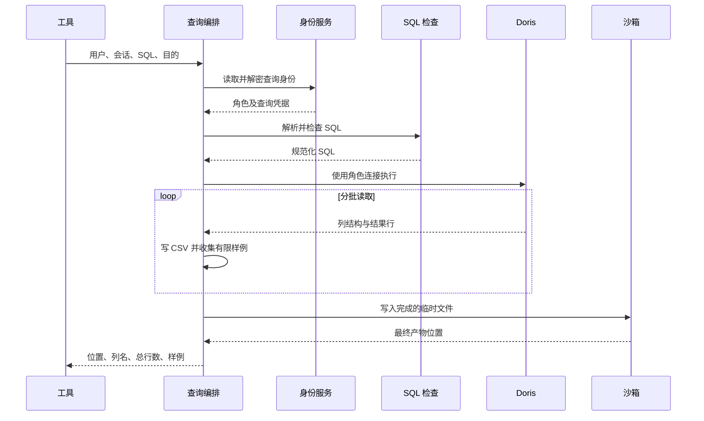

# 04. Query：受控 SQL 执行与结果交付

Query 接收用户、会话、SQL 和查询目的，解析角色查询身份，检查只读语句，流式执行 Doris 查询，并交付完整 CSV 和有限样例。模型负责业务口径，数据库负责实际访问权限。

## 1. 提供哪些功能

```text
Query：只读 SQL 与结果文件
├── 身份与静态检查（Explorer、服务调用方）
│   ├── 按用户读取角色查询账号和凭据
│   ├── 解析单条 SQL，检查只读语法和危险操作
│   └── 返回结构化校验问题，供模型修正
├── Doris 执行（Explorer）
│   ├── 使用角色连接池执行规范化 SQL
│   ├── 分批读取列结构和完整结果
│   ├── 识别权限拒绝与查询超时
│   └── 取消时使当前连接失效并传播取消
├── 结果交付（Agent、沙箱）
│   ├── 检查列名唯一性、批次结构和行列配对
│   ├── 序列化 CSV，处理日期、精度和公式文本
│   ├── 将完整文件写入当前会话工作区
│   └── 返回文件路径、列名、总行数和样例
└── 失败说明（Agent、用户）
    ├── 区分校验拒绝、权限不足及其他执行错误
    └── 权限不足返回 permission_denied，由 Agent 停止当前任务
```

## 2. 如何使用

### 2.1 执行一次查询

| 使用内容 | 代码位置 |
| --- | --- |
| QueryExecutionHandler | `app.query.services.execution_handler` |
| AnalysisQueryResult / QueryExecutionOptions | `app.query.models.execution` |
| 查询异常 | `app.query.errors` |
| Agent 工具 | `app.assistant.agents.tools.execute_sql` |

```python
# handler 由应用装配，身份和会话来自可信上下文。
result = await handler.execute(
    user_id,
    conversation_id,
    "SELECT COUNT(*) AS order_count FROM dwd_trade_order_detail_di",
    purpose="统计订单明细行数",
)
```

Handler 依赖沙箱管理器、身份库和角色连接池注册表。execute_sql 从运行上下文取得用户和会话，模型仅提供 SQL 和 purpose。新增调用入口应自行落实用户和会话归属检查。

### 2.2 读取返回结果

AnalysisQueryResult 包含 path、columns、row_count 和 sample。path 代表沙箱交付完成的位置，row_count 为实际读取的完整行数，sample 仅为理解结构而保留。

模型使用完整文件继续分析，不能将样例统计当成完整数据统计。返回结果不单独持久化为查询记录；长期保留内容主要是会话消息中的工具结果和沙箱文件。

### 2.3 处理失败

| 情况                    | 行为                               |
| ----------------------- | ---------------------------------- |
| SQL 校验失败            | 在连接执行之前拒绝                 |
| 数据访问权限不足        | 转换为 QueryPermissionDeniedError，工具返回 permission_denied |
| 其他 SQL 运行失败       | 工具返回错误说明和异常类型         |
| 超时                    | 识别并转换为查询超时错误           |
| 用户停止导致取消        | 使当前连接失效并传播取消           |
| 列结构异常              | 停止构建结果，关闭流与临时文件     |
| 沙箱写入失败            | 不返回成功摘要，临时文件退出后关闭 |

查询流在 finally 中关闭游标，执行服务通过 aclosing 管理生成器。取消时使连接失效，避免将正在执行或协议状态不确定的连接交回池中复用。

Doris 执行和沙箱写入没有共同事务。只读查询不会回滚源数据；权限拒绝不应自动重试，其他失败按具体错误决定修正或重试。

#### 权限拒绝的识别与交付

仓储从驱动异常中识别数据访问错误码，并处理 Doris 通用错误码 1105 包装的授权拒绝消息，包括 `SELECT command denied`、`Access denied` 和 `Permission denied: user ... does not have privilege for` 等限定格式。账号登录认证失败、SQL 语法错误和普通运行错误不归为数据授权不足。

execute_sql 捕获 QueryPermissionDeniedError，返回以下工具结果，不将该异常传播为整个 Run 的执行失败：

```json
{
  "status": "error",
  "code": "permission_denied",
  "message": "当前账号没有执行该查询所需的数据访问权限",
  "hint": "停止当前任务，将权限不足的原因告知用户，不重试或尝试绕过权限"
}
```

工具不返回成功产物摘要。Explorer 和 Planner 的停止、说明与不再调度行为由角色提示词约束，查询服务不取消会话或后台 Run。用户可在同一会话提出新的独立问题，后续查询仍由 Doris 检查权限。

## 3. 关键业务规则

### 3.1 SQL 与权限边界

QueryGuardService 用 SQLGlot 的 Doris 方言解析 SQL。空输入被拒绝，解析异常转换为校验问题。分号和尾部注释可能产生空节点，过滤这些节点后必须恰好保留一条语句。

普通查询要求是包含 SELECT 的查询表达式，允许 WITH 等查询结构。SHOW 只允许 TABLES 类型。通过检查后使用 Doris 方言重新生成规范化 SQL，执行层使用规范化结果。

校验遍历语法树，拦截写入和 DDL，也检查嵌套查询中的危险节点，避免只检查最外层 SELECT。

禁止范围包括文件导出、锁、Hint、会话或普通变量、赋值、占位符、命令节点，以及不符合查询要求的子查询结构。对匿名函数另外拒绝 sleep、benchmark、load_file、sys_exec 和锁函数等副作用调用。

这些规则限制查询操作，不推导表字段类型，不验证 JOIN 是否造成重复，也不自动证明聚合口径正确。SQL 即使通过 Guard，也可能因字段不存在、函数不兼容或权限不足在 Doris 失败。

Guard 是应用检查，Doris 查询账号是权限执行边界。新增允许语法时应同时检查 AST 结构和实际账号权限，而不是通过文本前缀判断只读。

### 3.2 结果结构

首次批次确定最终列顺序，并检查大小写不敏感的列名唯一性。重复列名会让样例字典覆盖数据，也会让 CSV 消费方无法可靠按名称引用，因此直接拒绝。

后续批次必须具有相同列定义。读取每行时按列名和列值严格配对，结构不一致不能通过补空值掩盖。

模型编写多表查询时，应为重复名称设置不同别名。这个约束是交付格式要求，不代表数据库本身不能返回重名列。

### 3.3 CSV 序列化

| 值类型             | 完整 CSV 表示            | 样例表示                  |
| ------------------ | ------------------------ | ------------------------- |
| None               | 空单元格                 | null                      |
| 布尔值             | true 或 false            | 布尔值                    |
| 整数、浮点数       | 文本数值                 | 原数值                    |
| 日期、时间         | ISO 文本                 | 文本                      |
| Decimal            | 字符串，保留十进制精度   | 文本                      |
| 二进制             | Base64                   | 文本                      |
| 列表、字典等嵌套值 | JSON 文本                | 限长文本                  |
| 字符串             | 完整文本，必要时公式转义 | 最多 512 字符后附截断标记 |

CSV 使用 UTF-8 和统一换行，由 csv.writer 处理分隔符和引号。完整文件中的字符串不会因为样例长度限制而截断。

字符串忽略前导空白和控制字符后，若首个有效字符是公式触发字符，会加前导单引号，避免电子表格打开时把源数据执行为公式。下游按原始字符串分析时需理解这一输出规则。

### 3.4 文件与内存

查询目的经过 Unicode 规范化，生成适合文件名的文本，再附加唯一标识。沙箱负责校验目标并返回最终产物位置，查询服务不自行决定底层容器位置。

完整结果持续写入本地临时文件；内存只保留一批数据和固定数量样例。默认 sample_rows 为 5，可设置为 0，模型约束最多 100。

流式读取降低内存需求，但不等于对磁盘占用或查询成本设了总上限。数据量很大时仍会占用临时存储，并在交付沙箱时受单文件和用户容量检查约束。

## 4. 内部实现

### 4.1 目录与组件

| 组件                  | 责任                                     | 不负责的内容   |
| --------------------- | ---------------------------------------- | -------------- |
| QueryExecutionHandler | 组织身份、校验、连接和执行服务           | SQL 业务正确性 |
| QueryGuardService     | 单语句和只读语法检查                     | 数据库实际权限 |
| DorisQueryRepository  | 服务端游标、分批读取及权限和超时错误分类 | CSV 和文件管理 |
| AnalysisQueryService  | 结果结构检查、序列化、临时文件、产物摘要 | 角色授权       |
| QueryExecutionOptions | 批大小与样例数量                         | 总行数限制     |
| AnalysisQueryResult   | 产物位置与摘要                           | 完整结果数据   |

服务接收已经明确的用户、会话和 SQL，不依赖 HTTP 请求对象。相同流程可以被 Agent 工具或其他受信任的业务入口复用，但新增入口仍需落实用户和会话归属。

| 位置 | 内容 |
| --- | --- |
| `app/query/services/execution_handler.py` | 用例编排 |
| `app/query/services/guard.py` | SQLGlot 校验 |
| `app/query/services/executor.py` | CSV 构建和产物交付 |
| `app/query/repositories/doris.py` | 流式查询及错误分类 |
| `app/query/models/` | 校验、执行选项与结果模型 |

### 4.2 执行顺序与事务



身份读取使用短事务。Doris 查询期间只占用它自己的查询连接，CSV 写完后游标和连接已经退出，再执行沙箱交付。失败在对应阶段传播，不会把不完整临时 CSV 作为成功结果返回。

### 4.3 游标与分批读取

DorisQueryRepository 使用连接的 stream 能力和结果分区读取。QueryBatch 同时包含 column_names 和 rows，使执行服务能够逐批处理。

默认 batch_size 为 100，它只控制每批读取量。查询不会自动附加总行数 LIMIT；需要限制数据量时由 SQL 明确表达。

没有数据行时仍返回一个带列名的空批次，使上层可以生成只有表头的 CSV。只有完全没有有效结果元数据才属于结果结构错误。

SQL 交给 SQLAlchemy text 前处理冒号，避免文本字面值中的冒号被误识别为绑定参数。此处执行的是已检查完成的 SQL，不向模型开放数据库绑定上下文。
