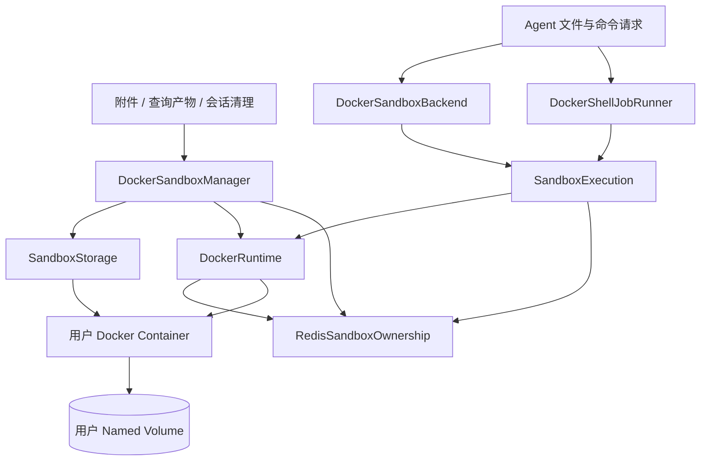

# 04. Sandbox：隔离工作区与执行资源管理

Sandbox 管理用户容器、持久数据卷、Conversation 和 Session 目录、文件访问、命令执行及资源回收。模块通过操作系统权限、容器限制和跨进程租约协调，向上层提供统一的文件与执行能力。

## 1. 提供哪些功能

```text
Sandbox：隔离工作区与执行资源
├── 工作区准备（Assistant、Query）
│   ├── 按用户创建容器与持久数据卷
│   ├── 准备 Conversation 根目录和 uploads 区域
│   ├── 为专业 Session 准备独立工作目录与执行身份
│   ├── 返回绑定用户和工作区的文件后端
│   └── 配置并挂载宿主机只读资源
├── 用户附件（聊天接口）
│   ├── 上传用户文件并返回规范化的会话相对路径
│   ├── 读取或下载当前会话的允许文件
│   ├── 删除 uploads 中的用户附件
│   └── 检查附件路径、文件大小与归属
├── 分析产物（Query、消息投影）
│   ├── 将文件对象写入指定 Session 并返回绝对路径
│   ├── 批量解析相对或绝对产物引用
│   ├── 检查普通文件、大小、属主和可下载性
│   └── 返回容器路径与下载相对路径，省略无效引用
├── Agent 文件操作（文件与图片工具）
│   ├── 按路径和范围读取文件
│   ├── 写入文本文件
│   ├── 局部替换文本或替换全部匹配内容
│   ├── 上传和下载二进制文件，为图片工具提供文件内容
│   └── 写入前检查目录身份，通过暂存与重命名提交
├── 命令执行（Agent、内部维护）
│   ├── 以工作区身份执行有时限的短命令
│   ├── 启动较长的 Shell 进程组并通知上层已启动
│   ├── 收集退出码、输出、截断标识和最终状态
│   ├── 取消 Shell 进程组并报告取消结果
│   └── 清理 Shell 控制资源并按需删除日志
├── 隔离与容量（全部沙箱操作）
│   ├── 通过 UID/GID 与权限位隔离 Session 写入
│   ├── 规范化路径并检查各入口可访问范围
│   ├── 应用容器断网、只读根文件系统和资源限制
│   ├── 控制同时运行容器数量，必要时回收空闲容量
│   ├── 通过 Redis 操作租约、维护门和锁协调多进程访问
│   └── 通过删除标记拒绝迟到请求重建资源
└── 清理与生命周期（Assistant、Workflows、应用入口）
    ├── 删除专业 Session 的文件与身份注册
    ├── 删除 Conversation 目录与身份注册
    ├── 删除用户容器和整个数据卷
    ├── 停止空闲容器或移除容器并保留数据卷
    ├── 规格变化时在维护窗口重建容器并复用原卷
    ├── 应用关闭时释放客户端、租约并按配置收尾容器
    └── 短任务退出时断开客户端并保留运行容器
```

## 2. 如何使用

### 2.1 取得管理器并调用

| 使用内容 | 导入位置 |
| --- | --- |
| 管理器、后端、Shell Runner 和路径操作 | `app.sandbox` |
| 只读挂载、Session 路径与 Shell 执行类型 | `app.sandbox.contracts` |
| 业务异常 | `app.sandbox.errors` |

实现按职责直接放在 `app/sandbox/`。Runtime、Execution、Storage 和 Redis 协调器属于模块内部实现。

| 创建参数 | 用途 |
| --- | --- |
| `SandboxConfig` | 管理器配置，并用于默认创建 Redis 协调器 |
| 协调器实例 | 测试时可显式注入替身 |
| `readonly_mounts` | 传入只读挂载 |

| 入口 | 参数与返回值 | 生命周期与边界 |
| --- | --- | --- |
| `init` | 可指定 `start_cleanup` | 初始化 Docker 与协调资源，按需启动清理任务 |
| `get_backend` | 用户、会话及可选的 `scope=SandboxSessionScope(...)`；返回工作区后端 | 未提供 scope 时准备 Conversation 工作区，提供时准备独立 UID 的 Session 工作区 |
| `write_artifact` | 用户、会话、Session 范围、文件名或 Session 内路径和二进制文件对象；返回绝对路径 | 目录拼接与归属校验由 Sandbox 完成，调用方不能写入其他 Session 或 uploads |
| `resolve_artifacts` | 用户、会话、引用集合及可选 Session 范围；返回输入引用到 `SandboxArtifact` 的映射 | 相对引用以会话或指定 Session 目录为基准，绝对引用也须位于同一范围内；批量检查普通文件、大小及属主，无效项省略，基础设施异常继续抛出 |
| `upload_user_attachment` | 会话身份和上传文件 | 上传限定在 uploads |
| `download_file` | 会话身份和附件路径 | 下载时校验文件归属 |
| `delete_user_attachment` | 会话身份和附件路径 | 删除限定在 uploads |
| `delete_session` | 用户、会话与 `SandboxSessionScope` | 在维护保护下清理目标 Session 目录与 UID 注册 |
| `delete_conversation` | 用户和会话标识 | 清理目标会话，维护删除标记与目录身份 |
| `delete_user_sandbox` | 用户标识 | 删除用户容器和卷，保留用户删除标记 |
| `close` | 无返回数据 | 回收客户端及租约，按配置和最后运行时状态收尾容器 |
| `disconnect` | 无返回数据 | 回收客户端及租约，保留运行容器供其他进程使用 |

应用生命周期负责创建、初始化和释放管理器，业务服务接收已创建的实例。获取 Backend 会准备工作区，执行时由共享的 `SandboxExecution` 获取容器并登记操作租约；Shell Runner 使用相同的执行上下文。

```python
from app.sandbox import DockerSandboxManager
from app.sandbox.contracts import SandboxSessionScope

sandbox = DockerSandboxManager(config, readonly_mounts=mounts)
try:
    await sandbox.init()
    backend = await sandbox.get_backend(
        user_id,
        conversation_id,
        scope=SandboxSessionScope(analysis_id, agent_type, session_id),
    )
    result = await backend.aexecute("ls")
finally:
    await sandbox.close()
```

`SandboxArtifact` 同时提供容器绝对路径 `path` 和下载相对路径 `relative_path`，供上层直接使用。消息投影通过 `resolve_artifacts` 校验最终回答和委派结果中的文件引用，实时与历史展示共用此入口。每批相同规范路径只检查一次，校验过程仅访问已有容器和工作区；下载时重新执行归属检查。Shell Runner 的启动通知、工作目录及取消结果供上层后台任务消费。

### 2.2 准备调用环境和工作区

调用前需准备可用的 Docker、配置的沙箱镜像和 Redis 协调服务。只读挂载源目录必须存在，并且能被 Docker 守护进程访问。初始化管理器会检查和准备运行资源，用户容器与工作区在具体访问时创建。

| 调用方提供的值 | 来源与作用 |
| --- | --- |
| `user_id` | 服务端确认的用户身份，用于定位专属容器和卷 |
| `conversation_id` | UUID，会话服务已确认归属，用于定位会话目录 |
| `SandboxSessionScope` | `analysis_id`、`agent_type`、`session_id`，定位专业 Agent 工作区 |
| `SandboxReadonlyMount` | 宿主机 `Path` 和容器 `PurePosixPath`，提供只读技能等资源 |

Sandbox 执行文件与容器隔离；HTTP 认证和用户是否拥有 Conversation，由调用方在进入模块前确认。

| 获取方式 | 返回后端的工作范围 |
| --- | --- |
| `get_backend(user_id, conversation_id)` | Conversation 工作区，供 Planner 使用 |
| `get_backend(user_id, conversation_id, scope=scope)` | 专业 Session 工作区，绑定独立执行 UID |
| `backend.workspace_dir` | 当前工作区的容器绝对路径 |
| `backend.conversation_dir` | 所属 Conversation 的容器绝对路径 |

后端对象绑定身份，同一实例的后续操作沿用该身份。服务间传递后端实例即可，无需逐个文件操作重新拼接工作区路径。

### 2.3 上传、下载和删除用户附件

附件用于用户输入资料，路径位于当前 Conversation 的 `uploads/`。以下片段在异步方法中使用应用已创建的 `sandbox`：

```python
from io import BytesIO

with BytesIO("region,amount\n华东,100\n".encode("utf-8")) as content:
    relative_path = await sandbox.upload_user_attachment(
        user_id,
        conversation_id,
        "uploads/sales.csv",
        content,
    )

file_bytes = await sandbox.download_file(user_id, conversation_id, relative_path)
await sandbox.delete_user_attachment(user_id, conversation_id, relative_path)
```

示例演示完整的上传、读取、删除生命周期。实际业务按用户操作分别调用；传入的二进制文件对象由调用方管理生命周期。

| 操作 | 成功结果 | 失败时关注什么 |
| --- | --- | --- |
| 上传 | 返回规范化的会话相对路径，如 `uploads/sales.csv` | 路径是否在 uploads、文件大小、Docker 和 Redis 状态 |
| 下载 | 返回文件的 `bytes` | 文件是否存在、是否允许下载、会话范围和属主 |
| 删除附件 | 返回 None，清理已有目标文件 | uploads 范围、维护锁和目录权限 |

上传可创建保持停止状态的容器。下载和有效性检查使用已有资源；文件不存在时可能抛出 `FileNotFoundError`，基础设施错误继续传播。

### 2.4 写入和交付分析产物

Query 等服务生成二进制文件后，用 `write_artifact()` 写入明确的专业 Session。相对路径以 Session 工作目录为基准，也可以传入该范围内的绝对路径。

```python
from io import BytesIO
from app.sandbox.contracts import SandboxSessionScope

scope = SandboxSessionScope("sales", "explorer", "regional-sales")
with BytesIO(b"region,total_amount\neast,100\n") as content:
    absolute_path = await sandbox.write_artifact(
        user_id,
        conversation_id,
        "regional-sales.csv",
        content,
        session_scope=scope,
    )

artifacts = await sandbox.resolve_artifacts(
    user_id,
    conversation_id,
    [absolute_path],
    session_scope=scope,
)
artifact = artifacts.get(absolute_path)
```

| 返回值 | 使用方式 |
| --- | --- |
| `write_artifact()` 返回的字符串 | 实际写入的容器绝对路径，供后续 Agent 或文件交付使用 |
| `resolve_artifacts()` 返回的映射 | 键是原始输入引用，值是通过下载检查的 `SandboxArtifact` |
| `SandboxArtifact.path` | 容器绝对路径 |
| `SandboxArtifact.relative_path` | 会话相对下载路径，供附件接口使用 |
| 输入引用未出现在映射中 | 路径无效、文件不存在或不可下载，不应生成附件 |

同一 Session 的相同路径会覆盖已有产物。解析引用会检查普通文件、大小和属主，重复规范路径只检查一次；Docker、Redis 等设施错误仍会抛出。检查通过与之后的下载是两次操作，文件可能在其间被删除或更新，因此下载时重新检查。

### 2.5 使用文件后端和短命令

取得后端后，可在其工作目录内读取、写入或编辑文件。异步服务使用对应的 `a*` 方法：

| 方法 | 主要输入 | 返回内容 |
| --- | --- | --- |
| `aread(file_path, offset=0, limit=2000)` | 文件路径与读取范围 | 框架的文件读取结果及错误信息 |
| `awrite(file_path, content)` | 路径和文本 | 写入路径或错误信息 |
| `aedit(file_path, old_string, new_string, replace_all=False)` | 待替换文本和替换方式 | 路径、替换次数或错误信息 |
| `aexecute(command, timeout=None)` | Shell 命令和可选短时限 | 输出、退出码和截断标识 |

```python
backend = await sandbox.get_backend(user_id, conversation_id, scope=scope)
written = await backend.awrite("notes.txt", "本轮分析说明")
if written.error:
    raise RuntimeError(written.error)

execution = await backend.aexecute("ls", timeout=10)
```

读写协议可能通过结果中的 `error` 表达失败，不能只凭方法正常返回判断成功。命令需要检查退出码；显式 `timeout` 受内部命令上限约束，不能用较大参数延长为无限运行。Docker 和容量错误仍可能作为异常传播。

### 2.6 运行较长的 Shell 作业

较长计算通过 `backend.shell_jobs` 提供的 `DockerShellJobRunner` 执行。Assistant 的 Shell Runtime 在其上管理作业 ID、60 秒前台等待、状态查询和委派结束清理。

| Runner 方法 | 用途与返回 |
| --- | --- |
| `arun(job_id, command, started_callback=None)` | 运行到结束，返回 `SandboxShellJobExecution`；不以 60 秒作为总执行时限 |
| `acancel(job_id)` | 请求取消进程组，返回控制信息是否就绪、是否已发信号、是否退出 |
| `acleanup(job_id, remove_log=False)` | 清理作业控制资源，按参数决定是否删除日志 |

作业 ID 由上层 Runtime 生成，格式为 `job_` 加 8 位小写十六进制字符。直接等待 `arun()` 会等待整个运行结束；希望前台先返回、之后再查询的调用方，应使用 Assistant 的作业管理能力。

| 最终状态 | 含义 |
| --- | --- |
| `completed` | 命令完成 |
| `failed` | 命令或运行环境失败，结合 `exit_code`、`error` 和输出判断 |
| `interrupted` | 输出流或终态异常，运行被识别为中断 |

输出字段区分内联截断和日志截断。命令运行、上层取消、控制文件清理是不同阶段，调用方需在委派结束或取消时完成收尾。

### 2.7 清理资源和释放管理器

| 目的 | 调用方式 | 结果 |
| --- | --- | --- |
| 删除某个专家工作区 | `delete_session(user_id, conversation_id, scope)` | 返回是否删除，由 Session 管理逻辑结合 Checkpoint 清理 |
| 删除整段会话文件 | `delete_conversation(user_id, conversation_id)` | 清理会话目录与身份注册，保留删除标记 |
| 注销用户的全部文件 | `delete_user_sandbox(user_id)` | 清理容器和整个数据卷，保留用户删除标记 |
| 应用关闭 | `close()` | 释放客户端和租约，按配置及最后运行时状态收尾容器 |
| 短生命周期任务退出 | `disconnect()` | 释放自身客户端和租约，保留运行中的容器 |

资源删除先进入维护保护，等待已有操作退出。容量不足、维护超时或 Redis 不可用时，由调用方保留业务清理进度并安排重试。关闭管理器与删除用户数据分别调用，普通请求结束无需关闭应用共享管理器。

## 3. 关键业务规则

### 3.1 工作区归属

```text
用户专属容器
└── /data/                       用户专属 Named Volume
    └── {conversation_id}/       一段对话
        ├── uploads/             用户上传的资料
        └── sessions/
            └── {analysis_id}/
                ├── explorer/{session_id}/
                ├── analyst/{session_id}/
                └── reviewer/{session_id}/
```

一个平台用户拥有一套容器和卷；一个 Conversation 有自己的根目录；一个专业 Session 有稳定的工作目录。目录由服务端的 Session 标识派生，不由模型自由选择归属用户。

同一 Conversation 的 Agent 可以读取被文件权限允许的上游结果，但只能修改自己的专业工作区。例如 Analyst 可以读取 Explorer 的 CSV，再把报告写入 Analyst 自己的目录，不必复制一份大 CSV 塞进模型消息。

Planner 使用 Conversation 级后端。其提示词要求只查看文件和组织工作、不直接计算或修改数据；这项分工约定与 Specialist 的 UID 写入隔离应分别理解。

### 3.2 路径访问范围

| 入口                      | 主要规则                                                                           |
| ------------------------- | ---------------------------------------------------------------------------------- |
| 用户附件路径              | 以会话目录解析相对或绝对路径；上传和删除限定在 `uploads`，对外返回会话相对引用 |
| Shell、文件读取、图片读取 | 按容器 POSIX 路径解析，相对路径以当前工作目录为基准                                |
| Specialist 写入和编辑     | 解析后仍须位于当前 Session 的可写工作区                                            |
| 对外附件引用              | 归属当前 Conversation，位于允许公开的 `uploads` 或 `sessions` 区域，并通过下载检查 |

文件路径处理步骤：

1. 确定当前操作的基准目录。
2. 将输入解析为规范化的绝对路径。
3. 检查当前操作允许的访问范围和路径长度。

| 输入或限制 | 规则 |
| --- | --- |
| `..` | 规范化后仍须位于当前操作允许的目录范围 |
| `~`、反斜杠、控制字符 | 拒绝 |
| 单个路径组件 | 最多 255 字节 |
| 总路径 | 最多 4096 字节，相对路径拼接工作目录后再次检查 |

读操作没有把所有路径都限制成 `/data` 前缀；实际能读取什么，还受容器文件权限和只读挂载控制。写入规则则更严格。

### 3.3 Shell 作业的使用语义

一次 `shell` 调用启动独立进程组，前台最多等待 60 秒：

- 已结束：直接返回输出字符串。输出被截断时附上保留的日志路径。
- 尚未结束：返回 `running`、`job_id`、运行时间和 `output_path`，模型用后续工具继续管理。

| 工具 | 操作 |
| --- | --- |
| `list_shell_jobs` | 列出当前运行时未消费的作业 |
| `get_shell_job` | 立即查询，或最多等待 60 秒 |
| `cancel_shell_job` | 请求取消作业 |

| 作业状态 | 查询行为 |
| --- | --- |
| 运行中或取消中 | 可重复查询 |
| 已结束 | 第一次读取终态后消费记录，再查返回不存在 |

状态响应不反复携带全部输出。命令输出保留有界的内联内容，超出时截取首尾；日志路径用于查看更多内容，日志自身也有控制。Shell Job 不能逐个预检命令创建的其他文件，不能把输出限制等同于整个磁盘配额。

取消步骤：

1. 向进程组发送 SIGTERM。
2. 等待退出。
3. 使用 SIGKILL 清理仍存活的子进程。

前台等待被取消时，命令可能先转为后台，由所属运行时继续收尾。Specialist 委派结束、运行时淘汰或应用关闭时，会清理尚存作业。

这些作业索引属于进程内 Shell Runtime，不是持久任务调度表。进程重启后不能承诺继续用旧 job ID 管理所有命令；异常输出流或缺失终态会被识别为中断。

### 3.4 资源限制与配额

当前默认容器断网、根文件系统只读、去掉全部 capabilities，并启用禁止新增权限。`/tmp` 使用独立 tmpfs，业务文件保存在 `/data` 卷中。

| 配置             | 当前默认值      |
| ---------------- | --------------- |
| 内存             | 2 GiB           |
| CPU              | 2 个 CPU 的配额 |
| 进程数           | 256             |
| 单文件 API 大小  | 50 MiB          |
| 用户存储目标上限 | 1 GiB           |
| 同时运行容器数   | 8               |
| 空闲停止         | 600 秒          |
| 空闲删除容器     | 3600 秒，保留卷 |
| 清理检查         | 每 60 秒        |

用户存储配置不等于所有驱动都提供硬配额。默认 `local` 卷驱动没有用户总容量硬限制；需要硬限制时，必须采用并正确配置支持配额的存储驱动。容器断网也不影响服务端去调用语言模型或 MCP，因为这些请求不是由断网容器发出。

### 3.5 删除与文件保留

| 操作 | 容器 | 用户卷与文件 | 协调状态 |
| --- | --- | --- | --- |
| 普通文件读取 | Archive 读取可使用停止的容器，命令读取需运行环境 | 不应因只读检查创建缺失工作区 | 操作期间登记租约 |
| 首次上传 | 可以创建但保持停止 | 创建所属用户和会话文件空间 | 受用户变更与路径检查保护 |
| 执行命令 | 按容量控制启动 | 沿用当前工作区 | 活跃操作阻止不安全回收 |
| 空闲停止/移除容器 | 停止或删除 | 保留 | 更新运行与活动状态 |
| 规格变化重建 | 安全维护窗口内重建 | 继续挂载原卷 | 拒绝不兼容的存储策略复用 |
| 删除 Session/Conversation | 必要时启动或重建以执行清理 | 只删除目标范围 | 清理目录身份，阻止迟到操作 |
| 删除用户 | 删除 | 删除整个卷 | 保留用户删除标记 |

Redis 租约、Docker 实际状态和文件系统是不同状态来源。进程退出、租约超时和命令退出分别处理；不能仅凭本地缓存判断容器容量，也不能把丢失的 job ID 当成所有子进程已可靠结束。

## 4. 内部实现

### 4.1 目录与组件



| 组件 | 职责 |
| --- | --- |
| Manager | 用户资源创建、附件/产物访问、Session 和 Conversation 清理 |
| Backend | 为一个工作区提供文件读取、写入、编辑及命令协议 |
| Paths | 相对/绝对路径归一、公开附件范围和 Session 路径派生 |
| Storage 与容器内脚本 | 工作区和 UID 注册、上传/下载、目录校验、原子提交与受控清理 |
| Ownership | 操作租约、维护门、容量锁、用户变更锁与删除标记 |
| Runtime | Docker 客户端、容器和数据卷、运行容量与空闲回收 |
| Execution | 工作区执行身份、操作租约、容器访问和异步取消传播 |
| Shell Runner | 启动进程组、收集输出、等待与取消 |

上层 ShellJobRuntime 管理模型可见的 job ID、状态消费及委派结束时收尾；本模块负责底层命令和容器资源。文件保存在卷中，不随一次工具调用结束删除。

### 4.2 执行身份与文件权限

容器的 UID 注册表保存稳定的会话及 Session 身份。Conversation 分配组身份，专业 Session 使用独立 UID。同会话共享读取与各 Session 独立写入，通过 UID/GID 和权限位共同表达。

专业 Session 的普通文件通常为 `0640`、目录为 `0750`、umask 为 `0027`；Conversation 根工作区使用更严格的权限。技能目录以只读方式挂到 `/skills/...`，供 Agent 使用预置分析能力。

因此，文件工具限制路径和 Linux 文件权限是两道不同的检查。Shell 能解析绝对路径，并不意味着它就能读取其他用户数据；同样，仅仅检查路径前缀也不能替代真实文件权限。

### 4.3 安全写入与提交

检查路径之后、真正写入之前，目录仍可能变化。例如某个路径组件被替换成符号链接，就可能把写入引向意外位置。

Agent 后端的写入步骤：

1. 上传文件到系统暂存区。
2. 由受控脚本逐层打开目标目录，拒绝跟随符号链接。
3. 检查目标所有权。
4. 通过重命名提交文件。

普通模型无法直接把暂存区当成自己的工作目录。

管理器通过 Docker Archive API 上传附件和查询产物时，也会校验目标目录、所有权、大小与写入结果。两条路径的实现不同，不能把文件上传笼统理解成“拼一个路径然后直接写”。

### 4.4 文件和短命令执行

`DockerSandboxBackend` 为 Agent 提供读取、写入、编辑及命令能力。读取二进制时按协议转换，编辑使用容器内脚本完成局部替换，避免来回搬运大文件。单文件 API 按 `max_file_bytes` 检查大小，默认 50 MiB。

同步 `execute` 主要用于内部检查或有明确时限的短命令。命令以工作区身份运行，超时受内部上限约束，默认 60 秒，输出流在退出时关闭。普通命令还会设置文件大小限制。

Agent 的 `shell` 使用 Shell Job 机制：前台等待 60 秒后，仍在运行的命令转为后台作业，通过 `get_shell_job` 查询结果或 `cancel_shell_job` 取消。

文件上传、下载和下载资格检查使用 Archive API，可以操作停止状态的容器；首次上传还可以创建一台保持停止状态的容器。Agent 文件后端和命令执行需要运行中的容器。删除 Session 或 Conversation 需要容器内清理命令，可能先启动容器，或根据尚存的卷重建容器。

文件执行与 Shell Job 共用流清理：关闭流时仅忽略 `ENOTCONN`，在 `finally` 中释放底层 HTTP 响应，其他异常继续传播。手工构造的归档文件和目录设置当前修改时间；读取前检查成员大小，截断归档仍报告读取错误。

### 4.5 跨进程操作协调

API 和 Celery Worker 可能同时访问一个用户的容器。DockerSandboxManager 用 Redis 记录操作租约、维护状态、容量互斥和删除标记。

| 机制               | 要解决的问题                                     |
| ------------------ | ------------------------------------------------ |
| 操作租约           | 声明当前仍在读写或执行，心跳续期，进程消失后过期 |
| 用户/会话维护门    | 删除或维护前阻止新操作，等待已有操作退出         |
| 容量锁和用户变更锁 | 串行化容量判断、容器创建、目录与注册表修改       |
| 删除标记           | 拒绝迟到请求重建已经删除的资源                   |

加锁顺序由所有权组件统一维护。例如用户删除先进入维护，再取容量和用户变更锁；容量回收不会一边长时间拿着全局容量锁，一边等待一个活跃用户结束操作。

| 协调参数 | 默认值 |
| --- | --- |
| 锁租期 | 60 秒 |
| 锁等待上限 | 60 秒 |
| 普通操作租约 | 30 秒，持续操作会续期 |

这些时限控制资源协调，SQL 和模型调用使用各自的业务超时。

### 4.6 容器回收和重建

容器带有部署、用户和规格标签。需要执行时才启动，达到运行上限时尝试停止最久未使用且没有活跃操作的容器。镜像、挂载或运行规格改变时，在安全维护窗口重建容器并继续挂载原卷。

卷驱动或存储策略不匹配不会被悄悄迁移。管理器会拒绝不安全复用，要求部署方处理存储或恢复配置。

空闲回收删除容器但保留卷；删除 Conversation 清理这段会话的目录和注册表；用户注销删除容器与卷。用户删除标记保留，以拒绝迟到请求，而不是把所有 Redis 键无差别清空。

多个进程共享沙箱时，每个进程退出先释放自己的运行时租约；只有满足最后一个运行时退出等条件，并启用相应配置，才会停止本部署管理的容器。关闭一个 Worker 的客户端连接不应直接删除用户文件。

## 5. 异常与排障

| 现象 | 优先检查 |
| --- | --- |
| 上传成功但执行失败 | Docker 可用性、容器是否运行、镜像与执行身份 |
| 文件生成后无法下载 | Conversation 归属、公开路径范围、文件存在性、大小和属主 |
| 专家无法修改文件 | 文件是否属于当前 Session；跨 Session 共享的是读取能力 |
| 容量不足 | 同时运行容器数、活跃租约、可回收空闲容器 |
| 回收或删除等待 | Redis 操作租约、维护锁、命令是否仍在执行 |
| 数据卷策略不匹配 | 卷驱动和驱动选项；恢复配置或处理现有存储后重试 |
| Shell job_id 不存在 | 是否已消费终态、委派是否结束、进程是否重启 |

先区分 Docker 容器、数据卷、文件和 Redis 租约各自状态，再处理故障。容器被空闲移除时文件仍保留在用户卷中；删除用户则清理整个卷。
