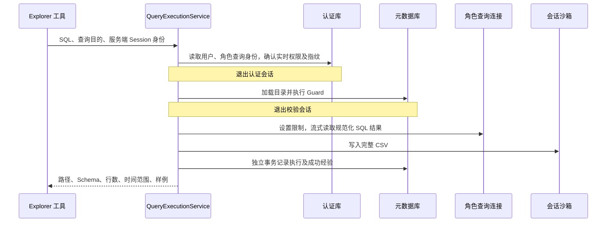
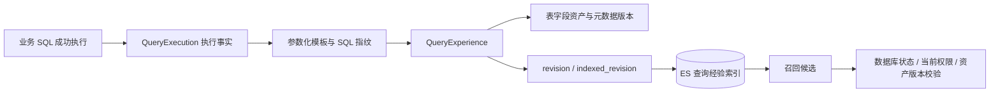

# 05. Query：受控 SQL 执行与查询经验管理

Query 接收业务 SQL 和可信 Session 身份，完成查询身份解析、静态校验、Doris 受限执行、CSV 交付、执行记录和经验聚合。模块保证查询经过确定性检查，并把完整结果与模型摘要分开保存。

## 1. 提供哪些功能

```text
Query：SQL 执行与查询经验
├── 查询身份与 SQL 检查（Explorer、服务调用方）
│   ├── 按可信用户和 Session 标识确定查询与产物归属
│   ├── 解析当前角色查询身份、有效授权和工作组
│   ├── 检查单条只读 SQL、危险表达式与外部 Catalog 限制
│   ├── 检查业务查询的 JOIN 关联规则
│   ├── 区分业务查询与目录查询，解析引用资产
│   └── 返回结构化拒绝原因，供调用方修正 SQL
├── 受限执行（Explorer）
│   ├── 使用角色专属查询账号连接 Doris
│   ├── 设置工作组、查询超时和内存限制
│   ├── 按批次流式读取完整结果
│   ├── 取消时处理当前连接并继续传播取消
│   └── 区分超时、结果结构异常与其他执行失败
├── CSV 与摘要交付（Agent、用户）
│   ├── 检查输出列名、批次结构和每行列数
│   ├── 序列化完整结果并处理特殊值与公式文本
│   ├── 生成列摘要、总行数、时间范围和有限样例
│   ├── 将 CSV 写入指定 Session，返回实际文件路径
│   └── 根据查询目的生成文件名，同路径写入覆盖旧产物
├── 执行记录（管理员、经验聚合）
│   ├── 记录成功、拒绝和失败事实
│   ├── 关联用户、角色、权限指纹、会话及工具调用
│   ├── 保留目的、原始 SQL、规范化 SQL 与校验结果
│   └── 保存结果摘要或错误分类，记录失败时保留查询本身的结果
├── 经验生成（成功业务查询）
│   ├── 将 SQL 字面量转为占位符，生成结构模板与指纹
│   ├── 按角色、权限指纹和 SQL 结构聚合经验
│   ├── 累积近期查询用途及来源执行
│   ├── 保存引用资产与元数据版本
│   └── 同结构查询再次成功时恢复符合条件的元数据失效记录
├── 经验召回（Assistant）
│   ├── 按角色与当前权限指纹过滤搜索候选
│   ├── 融合全文与向量检索结果
│   ├── 复核经验启用状态、当前资产权限与元数据版本
│   ├── 返回模板、用途和资产引用
│   └── 报告成功、部分可用或检索失败状态
├── 经验管理（平台管理员、Workflows）
│   ├── 按角色、状态和文本分页筛选经验
│   ├── 读取经验详情与来源执行记录
│   ├── 单条或批量禁用经验
│   ├── 单条或批量受理经验删除
│   └── 按变更表字段失效关联经验
└── 经验索引维护（后台任务）
    ├── 按 revision 同步经验搜索文档
    ├── 跟踪 indexed_revision 与待同步状态
    ├── 删除搜索文档后移除经验及关联，保留执行记录
    └── 定期扫描并补投未完成的索引任务
```

## 2. 如何使用

### 2.1 执行一次查询

跨模块服务从 `app.query` 导入，执行范围和返回类型从 `app.query.contracts` 导入。应用创建 `QueryExecutionService` 并注入调用方；`execute` 接收可信执行归属、SQL、查询目的和可选工具调用 ID。

以下示例位于异步业务方法中，`query_service` 为已注入的查询服务，用户和会话标识来自服务端上下文：

```python
from app.query.contracts import QueryExecutionScope

scope = QueryExecutionScope(
    user_id=user_id,
    conversation_id=conversation_id,
    analysis_id="sales",
    agent_type="explorer",
    session_id="regional-sales",
)
result = await query_service.execute(
    scope,
    "SELECT region, SUM(amount) AS total_amount FROM orders GROUP BY region",
    purpose="各地区销售额",
    tool_call_id=None,
)
```

结果通过 `result.path` 交付 CSV。工具入口只向模型开放 SQL 和 purpose，归属标识从运行配置取得。项目通过 Explorer 工具提供 SQL 执行能力。

### 2.2 查询输入、结果与失败处理

调用前确认用户和 Conversation 归属，并从服务端上下文构造执行范围。用户应已绑定可用 Doris 查询身份，Doris、目录数据库和 Sandbox 可用。

| 输入 | 含义与来源 |
| --- | --- |
| `QueryExecutionScope.user_id` | 当前用户，供 Identity 重新解析查询身份 |
| `conversation_id` | 当前 Conversation UUID，供审计和文件归属使用 |
| `analysis_id`、`agent_type`、`session_id` | 服务端确定的专业工作上下文，决定产物目录 |
| `sql` | 待执行的一条只读 SQL |
| `purpose` | 本次查询目的，同时用于生成 CSV 文件名 |
| `tool_call_id` | 关联工具调用；直接调用时仍需显式传入，可为 None |

例如，同一问题中的“各地区销售额”和“各地区退款额”应使用不同 purpose，以便区分结果文件。同一 Session 下清理后相同的文件名会被覆盖，历史记录中的路径也会指向覆盖后的内容。

成功返回 `AnalysisQueryResult`，表示结果已写入沙箱：

| 字段 | 调用方如何使用 |
| --- | --- |
| `path` | 容器绝对路径，交给后续 Agent 读取或通过 Sandbox 校验后交付用户 |
| `columns` | 列名、从返回值推断的类型和是否出现空值 |
| `row_count` | 本次完整结果的行数 |
| `time_range` | 可识别时间列的最小和最大值，按列名组织 |
| `sample` | 有界样例，用于模型判断数据形状；完整数据读取 CSV |

结果为零行时，只要 Doris 返回有效列信息，仍可交付带表头的 CSV。查询完成但上传失败时，整个用例返回失败，调用方不能把临时路径当成已交付产物。

| 失败阶段 | 表现 | 调用方处理 |
| --- | --- | --- |
| 查询身份解析 | Identity 的账号、角色或凭据异常 | 检查当前用户配置和 Doris 实际授权 |
| SQL Guard 拒绝 | `QueryRejectedError`，`result.issues` 包含代码、说明及可选表字段 | 根据具体问题修改 SQL |
| Doris 超时 | `QueryExecutionTimeoutError` | 缩小查询范围，检查工作组和资源参数 |
| 返回结构不适合 CSV | `QueryResultShapeError` | 检查列名、重复输出列及各批结果结构 |
| 执行或沙箱上传失败 | 原始执行或文件异常 | 结合失败阶段确认查询与产物状态，再决定重试 |
| 任务取消 | 继续传播取消 | 上层完成取消和资源收尾 |

执行服务尝试记录拒绝、失败和成功；记录自身失败只记日志，保留原查询结果或异常。得到成功结果不代表审计和经验一定已保存。

### 2.3 召回可参考的 SQL 经验

| 入口 | 用途 |
| --- | --- |
| `QueryExperienceService.recall(policy, query, limit)` | 按本次资产策略召回经验，返回结果及检索状态 |
| `QueryExperienceInvalidationService.invalidate_assets(table_names=..., column_keys=...)` | 失效依赖变更资产的经验 |
| `query_experience_index_scheduler.enqueue(experience_id, revision)` | 提交指定经验版本的索引同步，返回是否投递成功 |

调用时传入这次操作的资产策略、业务问题和数量上限：

```python
policy = await identity.asset_policy(user_id)
recall = await experiences.recall(
    policy,
    query="各地区销售额",
    limit=3,
)
```

示例位于异步方法中，`identity` 和 `experiences` 是已注入的公开服务。Query 的经验召回只返回本次结果，按 Conversation 保存和缓存由 Assistant 负责。

| 返回内容 | 含义 |
| --- | --- |
| `status=success` | 检索正常完成，结果仍可能为空 |
| `status=partial` | 存在可用搜索通道，返回通过权限与版本复核的结果 |
| `status=failed` | 两路搜索失败，当前没有可用检索结果 |
| `results[].id` | 经验标识 |
| `results[].purpose` | 经验用途 |
| `results[].sql_template` | 参数化 SQL 结构，供生成本次查询时参考 |
| `results[].assets` | 关联表字段及元数据版本 |

策略缺少角色或权限指纹时，返回 success 和空结果。结果中的 SQL 模板需要结合本次问题生成具体 SQL，执行仍调用 `QueryExecutionService.execute()`，使用当前身份重新校验。

### 2.4 管理员查看、禁用和删除经验

管理中心的查询经验页面要求管理员身份，接口前缀为 `/api/v1/admin/query-experiences`：

| 操作 | HTTP 入口 |
| --- | --- |
| 分页筛选查询经验 | `GET /api/v1/admin/query-experiences` |
| 批量禁用查询经验 | `POST /api/v1/admin/query-experiences/batch-disable` |
| 批量删除查询经验 | `POST /api/v1/admin/query-experiences/batch-delete` |
| 读取单条查询经验 | `GET /api/v1/admin/query-experiences/{experience_id}` |
| 删除单条查询经验 | `DELETE /api/v1/admin/query-experiences/{experience_id}` |
| 查看经验关联的执行记录 | `GET /api/v1/admin/query-experiences/{experience_id}/executions` |
| 禁用单条查询经验 | `POST /api/v1/admin/query-experiences/{experience_id}/disable` |

**查询和核对来源**

列表支持 `role_name`、`status` 和 `query` 筛选，分页使用 `limit`、`offset`，默认每页 20，最多 100。返回 `items`、`total`、`limit`、`offset`、`has_more`。

1. 从列表查看角色、状态、最近用途和索引状态。
2. 读取单条详情，查看完整模板、用途列表、引用资产及禁用或删除信息。
3. 查询来源执行，核对具体用户、Session、查询目的、行数和执行时间。

**修改状态**

| 操作 | 成功响应 | 后续行为 |
| --- | --- | --- |
| 单条禁用 | 返回更新后的经验详情 | 状态变为 disabled，记录管理员禁用原因并同步索引 |
| 批量禁用 | 204 | 请求体传入 `experience_ids`，应用相同禁用规则 |
| 单条删除 | 202，包含 `id`、`status=deleting` 和请求时间 | 后台先清理搜索文档，再删除经验及关联 |
| 批量删除 | 204 | 在同一事务中批量受理删除，实际清理由后台继续 |

批量请求包含 1—100 个经验 UUID。目标不存在或当前状态不允许操作时，按业务异常返回 404 或 409；批量操作事务回滚，成功提交后才逐项投递索引任务。原始执行历史保留；管理员禁用的记录不会因后续成功执行自动恢复。

禁用后的重新检索会过滤该经验。Assistant 已缓存或保存的历史快照可能暂时保留旧结果，需要区分重新检索与读取旧上下文。

### 2.5 元数据变更与索引恢复

Workflows 在目录提交后调用 `QueryExperienceInvalidationService`，通知哪些表或字段已经变化：

```python
invalidated_ids = await invalidation.invalidate_assets(
    table_names={"orders"},
    column_keys={("orders", "amount")},
)
```

`invalidation` 为已注入服务。返回值是本次受影响经验的 UUID 列表，状态变更在 Query 的短事务中完成，随后投递新 revision 的索引同步。

| 情况 | 处理方式 |
| --- | --- |
| 经验失效事务失败 | 异常向调用方传播，Workflows 停止后续步骤 |
| 索引调度器投递成功 | `enqueue(experience_id, revision)` 返回 true |
| 索引投递失败 | 返回 false 并记录日志，已提交经验状态保留，由修复扫描补投 |
| ES 同步未完成 | `indexed_revision` 落后于 `revision`，管理列表显示 pending |
| 删除清理完成 | 经验及关联从数据库移除，来源执行记录保留 |

调用方无需为每次请求创建独立的经验索引器。HTTP 管理用例和 Worker 各自负责资源生命周期，外部模块使用失效服务和索引调度入口。

## 3. 关键业务规则

### 3.1 身份与执行归属

工具接受 SQL 和 purpose，不接受用户 ID、Conversation ID 或任意输出目录。它从可信运行配置构造 Explorer 的 `QueryExecutionScope`，据此确定账号和 Session 路径。

查询身份来自平台用户及角色配置，策略来自 Doris 的实时有效授权。后台管理连接读取授权信息，SQL 执行连接使用角色的专属查询账号。Identity 与 Metadata 各自的会话在进入 Doris 执行前结束，避免长查询把无关 PostgreSQL 事务一直占着。

`purpose` 同时是执行记录中的业务目的和 CSV 文件名来源，应写清年份、地区、口径等关键范围。例如用“2025年华东销售总额”，比全部写“销售总额”更能区分文件。

### 3.2 SQL 规则与数据库权限

Guard 使用 SQLGlot 的 Doris 方言解析 SQL，拒绝空输入、无法解析或包含多条有效语句的输入。它检查只读语法，拦截写操作、锁、危险函数、未经允许的匿名函数、参数占位符及可能改变执行设置的 Hint。

物理表、别名、CTE、子查询与字段来源用于记录查询依赖。元数据目录只辅助解析，不作为 SQL 的访问白名单；目录中缺失的表或字段不会阻止查询，表和字段是否存在、字段是否有歧义以及访问权限均由 Doris 判断。目录不足时，只记录能够明确解析的字段依赖。

执行 SQL 保留原始字段引用和星号，不使用目录展开后的语句，避免过期目录改变查询结果或掩盖权限错误。Guard 不预检重复输出列名，执行器根据 Doris 返回的真实列名检查 CSV 结构。数据库访问范围由 Doris 查询账号的授权决定；Guard 检查外部 Catalog 限制以及 JOIN 关联规则。

目录查询包括 SHOW TABLES 和引用 information_schema 的只读查询，支持 JOIN、CTE、子查询和 UNION，不限制系统表名称或当前库，实际可见范围由 Doris 查询账号控制。引用 information_schema 的查询（包括与业务表混合查询）均归为目录查询，不执行业务分支的 JOIN 规则检查，也不会产生业务查询经验。

Guard 返回规范化 SQL、引用的表和列、输出列及问题列表。被拒绝时，工具返回这些问题，让模型可以修正。Doris 在实际执行时检查函数类型、语法支持和查询权限，并返回执行错误。

### 3.3 资源限制与取消

每条 SQL 执行前，仓储设置角色 Workload Group 和 Doris 查询限制。

| 参数 | 当前默认值 | 作用范围 |
| --- | --- | --- |
| `query_timeout` | 300 秒 | Doris 查询；不覆盖身份解析、等连接、写 CSV 和上传沙箱 |
| `exec_mem_limit` | 1 GiB | Doris 查询内存 |
| `batch_size` | 100 行 | 每批读取行数 |
| `sample_rows` | 5 行 | 返回给模型的样例数 |

批大小和样例数均不限制总结果行数。

服务器游标按批返回结果，退出时关闭游标。任务取消时会使当前连接失效，避免把状态不明确的连接放回池中，再继续传播取消。数据库超时被转换为明确的查询超时异常，其他执行错误保留原始原因供记录和工具投影使用。

### 3.4 CSV 交付与文件覆盖

执行器先创建临时文件，逐批检查列名和行结构，并写出 CSV。列名必须非空且大小写归一后不重复，各批列结构必须一致，每行列数必须正确。空结果仍可生成带表头的 CSV；完全没有有效结果元数据则报错。

完整结果持续写文件，内存只保存字段统计和有限样例。统计包括观测到的类型、是否出现空值、日期时间范围；这是根据返回值推断的结果摘要，不是对 Doris 原始字段类型的完整复制。

| 数据类型或内容 | CSV 表示 |
| --- | --- |
| 日期时间 | ISO 文本 |
| 二进制 | Base64 |
| 嵌套数据 | JSON |
| 空值 | 空单元格 |
| 可能被电子表格解释成公式的字符串 | 增加保护前缀 |

模型样例另有限长、集合数量和嵌套深度控制，CSV 保留完整值。

结果读完后上传沙箱，再返回 `AnalysisQueryResult`：

| 字段 | 作用 |
| --- | --- |
| `path` | 容器中的结果绝对路径 |
| `columns` | 列名、推断类型和空值信息 |
| `row_count` | 完整返回结果的行数 |
| `time_range` | 可识别日期时间列的范围 |
| `sample` | 有界的预览行 |

上传失败属于查询用例失败：虽然 Doris 可能已经读完，但没有可交付文件，就不能向模型宣称已成功产出 CSV。

文件名由规范化和字符清理后的查询目的加 `.csv` 组成。没有可用名称时回退为 `query_result.csv`。查询只把文件名、Session 身份和文件内容交给 Sandbox，由 Sandbox 决定目录并返回实际写入的绝对路径。

相同 Session 内相同或清理后相同的目的会写入相同路径，后续结果覆盖旧文件。旧执行记录中的路径也会指向更新后的文件。不同 Session 仍有不同目录。

文件名受 Sandbox 路径和文件系统限制，过长名称会导致写入失败。

### 3.5 经验生成与状态

成功执行的业务 SQL 才生成经验。系统把 SQL 字面量替换为占位符，生成结构模板和指纹，再按角色、权限指纹与 SQL 结构指纹聚合。

例如只改变年份的同结构 SQL 可以共享经验。相同权限下的记录更新用途和资产版本，用途去重后最多保留最近 5 条。不同权限指纹分别保存经验，避免互相覆盖；权限恢复后可再次召回原有经验。

经验提供成功 SQL 的结构参考。模型据此生成的 SQL 每次都经过 Guard，并由 Doris 按当前查询身份执行。

| 状态 | 行为 |
| --- | --- |
| `active` | 可以参与召回 |
| `disabled` | 不参与召回，保留禁用原因 |
| `deleting` | 先清理搜索索引，再删除数据库记录 |

经验关联物理表和字段的元数据版本。

| 状态变化原因 | 后续行为 |
| --- | --- |
| 元数据变更 | 停用相关经验；同结构 SQL 在新版本下再次成功时可以恢复 |
| 管理员主动禁用 | 成功执行同结构 SQL 也不会自动恢复 |

| 版本字段 | 含义 |
| --- | --- |
| `revision` | 经验当前版本 |
| `indexed_revision` | 索引已同步版本 |

同步步骤：

1. 提交经验事务。
2. 投递索引任务，按版本处理，防止旧任务覆盖新状态。
3. 投递或同步失败时，由默认每 300 秒运行的修复扫描补投未同步记录。

### 3.6 召回与缓存

重新检索经验时，按以下步骤执行：

1. 在 ES 中按当前角色和 `authorization_fingerprint` 过滤。
2. 并行搜索全文和向量结果，并通过 RRF 融合候选。
3. 到 PostgreSQL 检查经验仍为 active、元数据版本未过期且当前用户仍有相应资产权限。

| 检索参数或结果 | 当前规则 |
| --- | --- |
| 每路候选上限 | 100 |
| 向量默认阈值 | 0.65 |
| Explorer 使用经验数 | 最多 3 条 |
| 一路搜索可用 | 可以返回部分结果 |
| 两路搜索均失败 | 明确返回失败状态 |

不同读取方式的检查范围：

| 方式 | 角色、权限指纹与资产权限 | 经验启用状态与元数据版本 | 时间限制 |
| --- | --- | --- | --- |
| 重新检索 | 检查 | 检查 | 读取当前结果 |
| Assistant 组合召回复用缓存 | 检查，按当前资产权限过滤 | 不重新检查 | 缓存未满一天 |
| 显式读取已保存的召回快照 | 检查，按当前资产权限过滤 | 不重新检查 | 不检查缓存期限 |

经验被禁用或元数据变化后，缓存和历史快照仍可能保留相关经验。模型参考经验生成的 SQL，执行时仍须经过当前权限和 SQL Guard 校验。

## 4. 内部实现

### 4.1 目录与服务职责

```text
query/
├── __init__.py          跨模块公开入口
├── execution/
│   ├── service.py       查询身份、校验、执行和记录编排
│   ├── guard.py         只读 SQL 与关联规则校验
│   ├── executor.py      流式执行、CSV 写入和结果摘要
│   └── recorder.py      执行审计与成功经验聚合
├── experiences/
│   ├── management.py    经验查询、禁用和删除
│   ├── recall.py        混合召回与资产版本复核
│   ├── authorization.py 经验资产授权判断
│   ├── invalidation.py  元数据变更引起的经验失效
│   ├── indexer.py       Elasticsearch 投影同步
│   └── scheduler.py     经验索引任务提交
├── api/                 HTTP 参数、请求依赖与响应协议
├── repositories/        执行记录、经验、索引及 Doris 访问
├── models/              执行记录、经验与引用资产模型
├── contracts.py         公开请求、结果和执行范围
├── errors.py            业务异常与执行错误分类
└── tasks.py             索引任务执行、补偿扫描与资源释放
```

其他模块从 `app.query` 导入 `QueryExecutionService`、`QueryExperienceService` 和经验失效、索引调度能力，取得实例后直接调用业务方法。内部 SQL 校验器、执行器和仓储由 Query 自己使用；公开请求和结果类型位于 `app.query.contracts`。

| 组件 | 输入与职责 | 输出或持久化结果 |
| --- | --- | --- |
| QueryExecutionService | SQL、目的、QueryExecutionScope；编排完整用例并管理查询记录会话 | 查询结果或原始失败 |
| QueryGuardService | Doris 方言 SQL、目录 | 规范化 SQL、引用资产和问题列表 |
| AnalysisQueryService | 已校验 SQL 与结果批次 | CSV、列摘要、行数、样例 |
| DorisQueryRepository | 查询连接与资源限制 | 服务器游标和结果批次 |
| QueryExecutionRecorder | 成功/失败事实及资产版本 | 执行记录、经验与索引任务 |
| QueryExperienceIndexer | 经验 revision 与状态 | ES 文档、indexed_revision 或删除完成 |
| QueryExperienceService | 资产策略、问题文本；混合召回、版本复核与失效处理 | 有效经验候选及检索状态 |
| QueryExperienceManagementService | 管理员禁用、删除和查询 | 状态变化与来源记录 |

用户登录与授权规则由 Identity 提供，目录由 Metadata 提供，文件提交由 Sandbox Manager 完成。Query 负责使用这些依赖完成一次查询，不接管它们的生命周期规则。

管理接口在 `api/dependencies.py` 内创建请求级经验管理服务；后台任务在 `tasks.py` 内直接创建索引器。Web 启动入口创建可共享的查询执行和经验召回实例，单次操作的数据保存在局部变量及短会话中。

### 4.2 执行流程与事务



`QueryExecutionService` 在 `execution/service.py` 中按以下顺序完成查询：

1. 调用 `IdentityService.resolve_query_principal()` 解析身份。
2. 通过 `MetadataReader` 加载目录，由 Guard 校验 SQL。
3. 拒绝未通过 Guard 的结果，关闭身份和目录读取会话。
4. 将已确认的 `normalized_sql` 交给执行器，执行查询并交付 CSV。
5. 使用独立查询会话记录结果，保留原始 SQL、规范化 SQL 和完整校验结果。

| 执行组件 | 职责 |
| --- | --- |
| `AnalysisQueryService` | 检查结果形状，生成 CSV 和摘要 |
| `DorisQueryRepository` | 管理 Doris 连接、会话参数和游标 |

`QueryExperienceService` 在 `experiences/recall.py` 中完成混合召回、版本复核和失效处理，其会话顺序为：

1. 读取经验候选后关闭查询会话。
2. 读取元数据版本。
3. 在新的短事务中复查并更新经验。
4. 事务提交并关闭会话后，调度失效索引任务。

### 4.3 执行记录与错误分类

| 情况 | 执行记录错误码 | 记录状态 |
| --- | --- | --- |
| SQL 校验拒绝 | `sql_validation_failed` | `rejected` |
| Doris 查询超时 | `query_timeout` | `failed` |
| 列或行结构无效 | `query_result_invalid` | `failed` |
| 其他执行或产物错误 | `readonly_query_failed` | `failed` |

分类集中在 Query 错误模块。Handler 负责记录并继续抛出原异常；工具层负责文案、修正 hint 和可供模型读取的校验结果。取消不被普通 `Exception` 分支包装成查询失败。

查询身份成功解析后，被拒绝、失败和成功都会尝试记录。身份本身解析失败时，没有可靠的角色上下文，当前不写执行记录。

记录保存用户、角色、权限指纹、会话、Session、工具调用、目的、原始与规范化 SQL、状态、错误和结果摘要。它没有单独的完整执行耗时字段。成功结果记录不保存整个 CSV 或全部样例。

记录故障只记日志，不把已成功返回的结果改成失败，并保留查询本身的错误。这意味着一次成功查询可能没有成功写入审计或经验，不能把“记录尽力而为”解释成强制审计成功。

### 4.4 执行记录、经验和索引



- 执行记录关联用户、Conversation、Analysis、Session、工具调用及当次权限环境；记录不嵌入完整 CSV。
- 经验按角色、权限指纹和 SQL 指纹聚合，资产关联保存稳定资源键与元数据版本。
- 经验删除先进入 deleting，清理搜索文档后移除经验及关联，原始执行历史保留。
- 元数据失效与管理员禁用使用不同原因，决定成功查询能否重新激活经验。
- ES 是派生检索数据，数据库状态和版本才是最终校验依据；旧索引命中不能绕过状态检查。
- 相同 Session 的同名 CSV 可能被覆盖，历史路径不代表不可变的数据快照。
- 执行记录尽力保存，记录失败不改写查询结果；对强制审计成功有额外要求时，需要单独改变业务约束。

## 5. 异常与排障

| 现象 | 优先检查 |
| --- | --- |
| SQL 校验拒绝 | 工具返回的校验问题、语句数量、只读语法、Catalog 和 JOIN 规则 |
| Doris 执行失败 | 查询账号、实际授权、工作组、超时和数据库错误 |
| 结果格式错误 | 返回列名、重复列名、批次结构、每行列数 |
| 数据已读取但工具失败 | 临时 CSV、沙箱上传、文件大小和路径限制 |
| 同名文件内容变化 | purpose 清理后的文件名和当前 Session |
| 成功查询没有经验 | 是否为业务查询、记录事务日志、权限指纹、索引 revision |
| 经验未被召回 | active 状态、角色和指纹、资产权限、元数据版本、检索通道 |
| 已禁用经验仍出现在上下文 | Assistant 是否复用了缓存或保存快照；重新检索与显式读取的校验范围不同 |

查询错误与记录错误分别保留日志。记录写入失败时，已成功生成的查询结果仍可返回。
