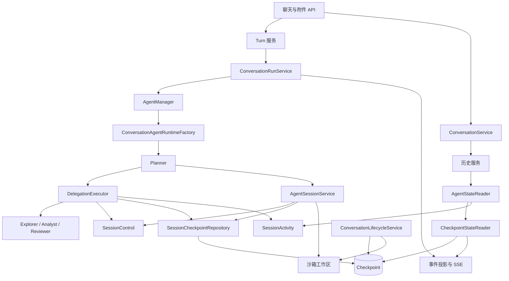
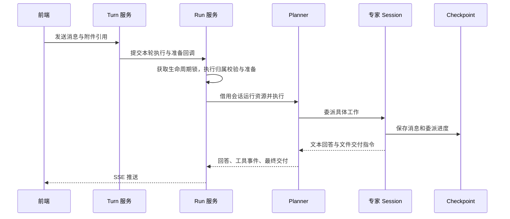

# 06. Assistant：对话执行与多智能体协作

Assistant 管理用户 Conversation、Planner 调度、专业 Agent Session、Checkpoint、流式事件、附件投影和会话清理。Agent 负责推理与分析，执行服务负责互斥、状态保存、恢复、取消和资源释放。

## 1. 提供哪些功能

```text
Assistant：对话与多智能体协作
├── 会话目录（聊天页面）
│   ├── 创建正式会话或草稿会话
│   ├── 查询用户会话列表与持久历史
│   ├── 首次发送时将草稿转为正式会话
│   ├── 生成初始标题并提交后台标题生成
│   ├── 手动修改标题并避免被后台结果覆盖
│   └── 受理批量会话删除或放弃草稿
├── 回合与运行控制（聊天 API）
│   ├── 接收新消息与附件引用，启动 Planner 回合
│   ├── 从 Checkpoint 恢复待执行工作
│   ├── 查询当前 Run 是否运行
│   ├── 订阅已存在的 Run，断线后重新连接
│   ├── 显式停止运行并执行取消收尾
│   └── 通过会话锁协调执行与生命周期操作
├── 专家协作（Planner）
│   ├── 按任务目标委派 Explorer、Analyst、Reviewer
│   ├── 并行执行独立委派，按依赖安排后续工作
│   ├── 创建或续接专业 Agent Session
│   ├── 查询专家 Session 列表及状态
│   ├── 删除指定 Session 的 Checkpoint 和文件
│   ├── 记录委派状态与正文，重放时复用已保存结果
│   └── 控制专家并发、Session 容量与同一上下文互斥
├── 专家能力与资源（Agent 运行时）
│   ├── 为 Explorer 提供元数据召回、查询经验和 SQL 工具
│   ├── 为 Analyst 挂载只读分析技能
│   ├── 为 Reviewer 提供检查数据与产物的工具
│   ├── 按角色加载提示词、模型和文件工具
│   ├── 按模型能力提供图片查看工具
│   ├── 加载供 Explorer 使用的 MCP 工具
│   └── 管理模型客户端、Shell 作业与会话运行资源缓存
├── 实时与历史消息（前端订阅者）
│   ├── 推送完整消息、正文增量和思考增量
│   ├── 推送工具调用、专家消息与委派状态
│   ├── 发送心跳、错误和流完成事件
│   ├── 重放当前 Run 的有界事件缓冲
│   ├── 读取指定专家委派的历史消息
│   └── 从 Checkpoint 整理公开历史并过滤内部消息
├── 召回上下文（Explorer 工具）
│   ├── 按稳定 query 组合语义资源与查询经验检索
│   ├── 累积检索结果，首次返回全量、后续返回增量
│   ├── 列出近期 query 摘要并读取指定 query 全量
│   ├── 合并 query 的语义资源并删除来源
│   ├── 删除整个 query 或指定表、字段、值、指标和经验
│   ├── 按角色、权限指纹与期限复用经验缓存
│   └── 按当前权限过滤新检索和显式读取的快照
├── 附件与文件交付（用户、消息展示）
│   ├── 上传用户附件并绑定会话路径
│   ├── 下载会话附件与分析产物
│   ├── 删除用户上传的附件
│   ├── 模型调用前准备附件上下文
│   ├── 识别最终回答中的产物指令，校验并去重为附件
│   └── 在实时和历史展示时重新检查文件可下载性
└── 会话资源清理（后台任务、Workflows）
    ├── 标记会话删除并从列表隐藏
    ├── 清理会话 Checkpoint、召回记录、文件和目录数据
    ├── 回收过期草稿并重试待删除会话
    ├── 注销时清理用户全部会话及残留状态
    └── 创建和释放后台清理所需资源
```

## 2. 如何使用

### 2.1 聊天页面与 HTTP 调用

用户登录并绑定查询角色后，可新建会话、上传资料并发送分析问题。后端把工作过程通过 SSE 返回；前端可查看专家详情、停止分析和下载产物。

接口前缀为 `/api/v1/chat`，所有资源操作检查身份及会话归属：

| 操作 | HTTP 入口 |
| --- | --- |
| 创建会话，通过 is_draft 指定草稿 | `POST /api/v1/chat/create` |
| 批量请求删除会话 | `POST /api/v1/chat/delete` |
| 删除草稿会话 | `DELETE /api/v1/chat/draft/{conversation_id}` |
| 更新会话信息 | `POST /api/v1/chat/update` |
| 列出当前用户会话 | `GET /api/v1/chat/ls` |
| 读取会话历史 | `GET /api/v1/chat/ls/{conversation_id}` |
| 读取指定专家委派的消息 | `GET /api/v1/chat/{conversation_id}/subagents/{analysis_id}/{agent_type}/{session_id}/runs/{delegation_id}/messages` |
| 发送消息并接收流式事件 | `POST /api/v1/chat/stream` |
| 继续执行会话 | `POST /api/v1/chat/{conversation_id}/resume` |
| 查询当前 Run 状态 | `GET /api/v1/chat/{conversation_id}/run` |
| 订阅当前 Run 的事件 | `GET /api/v1/chat/{conversation_id}/events` |
| 停止当前 Run | `POST /api/v1/chat/{conversation_id}/stop` |
| 上传会话附件 | `POST /api/v1/chat/attachment/upload` |
| 删除会话附件 | `POST /api/v1/chat/attachment/delete` |
| 读取或下载会话附件 | `GET /api/v1/chat/attachment/get` |

首次执行步骤：

1. 创建会话，取得 `conversation_id`。
2. 按需上传资料。
3. 提交含 `conversation_id` 和用户消息的 stream 请求，并读取 SSE。

| 后续操作 | 调用方式 |
| --- | --- |
| 连接断开后继续查看 | 查询 run 状态，运行中订阅 events |
| 读取已完成内容 | 调用历史接口 |

### 2.2 创建会话并发送消息

创建、上传、发送、恢复和运行控制要求用户已认证且具备分析资格。读取列表和历史、改名、删除会话及下载附件使用当前用户身份，并检查资源归属。

先向 `POST /api/v1/chat/create` 提交：

```json
{
  "is_draft": true,
  "initial_message": "分析各地区销售额"
}
```

| 字段 | 含义 |
| --- | --- |
| `is_draft` | 是否创建草稿，默认 false；前端新建使用 true |
| `initial_message` | 用于生成初始标题，不会自动启动 Agent 执行 |
| 响应 `conversation_id` | 后续消息、附件和历史操作使用的 UUID |
| 响应 `title`、`update_at` | 当前标题与更新时间 |
| 响应 `running` | 当前运行状态 |

取得 Conversation ID 后，向 `POST /api/v1/chat/stream` 提交消息。下例 UUID 需替换为实际创建结果：

```json
{
  "conversation_id": "00000000-0000-0000-0000-000000000001",
  "message": {
    "parts": [{"type": "text", "text": "分析各地区销售额，并生成图表"}],
    "attachments": []
  }
}
```

`parts` 保存文本或图片片段，附件通过已上传文件的 `f_path` 引用。用户身份由认证取得，前端无需传用户 ID 或专家 Session 身份。

后端取得会话锁后准备本轮输入，将草稿转为正式会话，并按标题条件提交生成任务。模型执行通过 SSE 返回；HTTP 成功建立连接表示开始订阅，还需读取执行事件确认结果。

### 2.3 消费 SSE 与读取完成结果

每个 SSE 数据帧的 `data` 是一个 JSON 对象，以 `type` 区分。心跳使用注释帧 `: keep-alive`，客户端跳过即可。

| `type` | 客户端如何处理 |
| --- | --- |
| `message` | 按消息 ID 保存或更新完整消息，读取正文、工具片段及附件 |
| `message_delta` | 按 `message_id` 追加正文；`reset=true` 时先清空该消息正文 |
| `thinking` | 按 `message_id` 追加思考；按独立的 reset 标志处理 |
| `subagent_message` | 将完整专家消息归到对应 `delegation_id` |
| `subagent_message_delta` | 追加指定委派的专家正文 |
| `subagent_thinking` | 追加指定委派的专家思考 |
| `subagent_status` | 更新对应委派的 running、completed、failed 或 cancelled 状态 |
| `error` | 展示 `content` 中的错误，保留已收到内容并允许查询历史 |
| `done` | 本次流的完成事件，结束当前订阅展示 |

专家事件同时提供 `analysis_id`、`agent_type` 和 `session_id`，用于关联工作上下文。`done` 是流协议事件，业务问题是否解决还需查看最终回答及专家结果。

完成后调用 `GET /api/v1/chat/ls/{conversation_id}` 获取持久历史。历史返回 `messages`，每条含角色、消息片段、附件和可选完成原因；内部系统消息已过滤。专家详情通过委派历史接口读取，需提供对应 Session 身份和 `delegation_id`。

### 2.4 断线、恢复与停止

| 当前情况 | 应调用什么 | 后续处理 |
| --- | --- | --- |
| 浏览器断线，后台仍在运行 | 查询 run，随后订阅 events | 消费当前 Run 的重放窗口和后续事件 |
| 当前运行已结束 | 历史接口 | 读取持久消息，不依赖已经释放的 SSE 缓冲 |
| Checkpoint 中存在待执行工作 | resume | 创建恢复执行并返回 SSE，无需重发原消息 |
| 用户提出新的补充问题 | stream | 发送新消息，开始新回合 |
| 用户主动取消 | stop | 请求取消当前 Run，随后查询状态和历史 |

run 接口只返回 `running`。false 本身不表示存在可恢复任务，resume 会进一步检查 Checkpoint；没有待执行工作时返回业务错误。重连只需订阅，重复发送 stream 会被当作新输入。

多 API 进程部署时，run、events、stop 请求需到达持有执行的进程。跨进程锁防止冲突执行，但无法转发事件或取消指令。会话忙碌时先确认原执行状态，再决定等待或停止。

### 2.5 上传资料与下载产物

1. 创建或选择所属 Conversation。
2. 向 `POST /api/v1/chat/attachment/upload` 发送 multipart 请求，字段为 `conversation_id` 和 `file`。
3. 读取响应 `attachment.f_path`。
4. 在下一次消息的 `attachments` 中传入该路径，例如 `{"f_path": "uploads/sales.csv"}`。

| 操作 | 参数 | 返回或生效方式 |
| --- | --- | --- |
| 上传 | multipart 的 Conversation ID 和文件 | 返回附件信息，路径指向 uploads |
| 下载 | 查询参数 `conversation_id`、`f_path` | 返回文件内容和下载文件名 |
| 删除用户附件 | JSON 的 `conversation_id`、`f_path` | 删除 uploads 中目标附件 |
| 下载 Agent 产物 | 使用回答附件中的 `f_path` | 同样检查会话归属和文件可下载性 |

Agent 在最终回答中使用独占行的 `[[DATAAGENT_ARTIFACT:<absolute_path>]]` 交付文件。消息投影通过 Sandbox 检查后生成附件，前端使用响应附件列表，而非自行相信任意正文路径。

文件可能在生成后被覆盖或删除。附件曾经展示成功不保证之后每次下载都成功；下载失败时检查文件状态、路径范围和所属会话。

### 2.6 跨模块使用召回与清理能力

其他模块从 `app.assistant` 导入服务，数据类型从 `app.assistant.contracts` 导入。调用方接收已创建的服务实例，直接调用方法。

| 公开入口 | 方法与用途 |
| --- | --- |
| `SemanticRecallService.recall_context()` | 检索并累积上下文 |
| `SemanticRecallService.list_recalls()` | 查询 query 摘要列表 |
| `SemanticRecallService.get_recall()` | 读取指定 query 的累计结果 |
| `SemanticRecallService.merge_recalls()` | 合并 query 上下文 |
| `SemanticRecallService.delete_recalls()` | 删除 query 或指定资源 |
| `ConversationLifecycleService.request_conversation_deletion()` | 标记会话删除 |
| `ConversationLifecycleService.delete_conversation_resources()` | 清理单个会话资源 |
| `ConversationLifecycleService.delete_user_conversations()` | 清理用户的全部会话 |
| `conversation_lifecycle_resources()` | 为后台清理提供独立资源上下文及会话服务、沙箱实例 |

以下示例在异步业务方法中使用已注入的 `recalls`，用户和会话标识来自服务端上下文：

```python
from app.metadata.contracts import SemanticResourceRecallRequest

update = await recalls.recall_context(
    user_id,
    conversation_id,
    query="月度销售收入",
    request=SemanticResourceRecallRequest(
        terms=["销售收入", "订单日期"],
        resource_types=["column", "metric"],
    ),
)
record = await recalls.get_recall(user_id, conversation_id, "月度销售收入")
```

清理调用由会话管理或注销工作流发起。后台资源上下文负责退出时释放连接及本进程租约，业务方法负责目标会话的实际删除。

### 2.7 累积和管理召回上下文

适用于 Explorer 分多次补齐同一个分析目标的信息。`query` 是稳定业务键，例如“月度销售收入”，后续补充地区或日期字段时复用该键，只调整检索词和资源类型。

| 服务操作 | 输入与返回 |
| --- | --- |
| `recall_context(user_id, conversation_id, query, request)` | 返回 `SemanticRecallUpdate`，包含当前累计 `record`、合并前 `previous` 和本次资源检索 `recalled` |
| `list_recalls(user_id, conversation_id, limit)` | 返回最近记录；服务层返回记录对象，工具再投影成摘要 |
| `get_recall(user_id, conversation_id, query)` | 返回当前权限过滤后的累计记录 |
| `merge_recalls(user_id, conversation_id, target_query, source_query)` | 合并语义资源，删除来源 query，返回目标记录 |
| `delete_recalls(user_id, conversation_id, deletions)` | 删除整个 query 或其中指定资源，返回 None |

一次完整的使用过程：

1. 用稳定 query 首次调用 `recall_context`，取得元数据和查询经验。
2. 需要补充信息时复用 query 再次检索，服务在写锁内合并快照。
3. 随时通过 `get_recall` 读取当前累计全量。
4. 两个 query 实际属于同一目标时显式合并；目标自己的经验保留。
5. 不再需要的上下文通过删除契约清理。

服务返回值与模型工具结果分别使用：服务提供完整更新对象，工具首次投影为 full、后续投影为 delta，并返回本次召回数量。失败或截断从本次检索结果读取，不能只凭 delta 为空判断没有命中。

调用方传入可信用户与会话身份。授权失败会中断操作；经验搜索失败时可以保留语义资源结果；快照保存失败会抛出 `SemanticRecallSaveError`，不能宣称累计上下文已更新。

### 2.8 Agent 分工与专家续接

| Agent | 主要职责 | 主要能力 |
| --- | --- | --- |
| Planner | 拆解问题、安排依赖、组织最终回答 | 委派专家、查看与删除专家 Session、读取文件、Shell 和图片工具 |
| Explorer | 弄清数据含义，取得可信的数据 | 元数据与查询经验召回、SQL 执行、配置的 MCP 工具，以及文件和 Shell 工具 |
| Analyst | 对已有数据进行计算、分析和展示 | 分析技能、文件与 Shell 工具、模型支持时的图片查看 |
| Reviewer | 检查口径、计算、证据和交付物 | 文件与 Shell 工具、模型支持时的图片查看 |

`agents/runtime.py` 的 `create_specialist` 在委派时按以下顺序准备专家：

1. 取得 Session 沙箱并创建 Shell 运行资源。
2. 按专家类型加载提示词和工具；Explorer 组合召回、SQL 与共享 MCP 工具，Analyst 挂载技能。
3. 通过公共 `create_agent` 创建专家。

共用的委派持久化状态位于 `agents/specialist_state.py`。

Analyst 和 Reviewer 没有直接配置 SQL 查询或元数据召回工具。需要补数时，它们应把缺口返回给 Planner，由 Planner 再安排 Explorer。专家也没有继续创建子 Agent 的默认工具，避免分析过程形成不受控制的嵌套委派。

工具请求模型由框架在入口校验，非法参数返回框架工具错误，不执行业务。委派工具的运行时字段由框架注入并从模型 schema 隐藏；召回工具通过 RunnableConfig 接收服务端身份。业务执行失败按工具错误码和分类返回，取消向上传播。图片工具保存路径引用，读取已持久化请求时独立校验。

Planner 的提示词要求它专注协调，不亲自做 SQL 和数据加工。这是工作分工约定，不能单独当作安全边界；实际权限仍由工具集合、后端身份校验和沙箱文件权限共同决定。

Planner 委派时提供以下业务参数：

| 参数 | 用途 |
| --- | --- |
| `analysis_id` | 当前 Conversation 中的一组分析目标 |
| `agent_type` | explorer、analyst 或 reviewer |
| `session_id` | 专家可续接工作区，继续同一工作时复用 |
| `message` | 本次目标、输入产物路径、约束和需要交付的内容 |

委派 ID 由框架的工具调用 ID 提供，用户与 Conversation 从运行上下文绑定。首次使用 Session 时创建工作区；同一 Session 接收新的委派时续接消息和文件。

例如，Planner 先委派 Explorer 查询销售额，随后将返回的 CSV 路径交给 Analyst。发现漏了退款口径时，再给原 Explorer Session 发起新委派，复用已有探索上下文。每次委派结果独立记录，工具重放才复用同一委派 ID 的已有结果。

委派正常返回 `DelegationResult`，包含 completed 或 failed、Session 身份和原始 `content`；取消由执行状态单独记录。`list_sessions` 用于发现已有工作区，`delete_session` 清理指定 Session 的 Checkpoint 与沙箱资源。

#### 直接工具委派

Planner 直接调用 `delegation` 委派专家。独立任务可以在同一轮发起多个工具调用并行执行，有依赖的任务则等待前一步结果。专业 Agent 的数据分析在 Docker 沙箱中执行。

委派记录随状态保存，前端通过 `delegation` 工具调用 ID 关联专家活动，展示实时过程和历史记录。取消执行与专家并发控制由执行链负责。

### 2.9 改名、删除与后台清理

| 用户操作 | 输入与结果 |
| --- | --- |
| 修改标题 | update 请求传 `conversation_id`、`title`，标题去除首尾空白后为 1—64 字符 |
| 批量删除会话 | delete 请求传 `conversation_ids`，按生命周期规则标记和安排清理 |
| 放弃草稿 | 调用 draft 删除接口；只处理仍为草稿的目标 |
| 查看清理结果 | 会话列表隐藏已标记删除项，实际资源清理由后台完成 |

Workflows 和清理任务使用公开的 `ConversationLifecycleService`：

| 方法 | 返回与调用约束 |
| --- | --- |
| `request_conversation_deletion(user_id, conversation_id)` | 有效目标标记删除后返回 true；目标不存在或不满足草稿条件时返回 false。内部负责生命周期互斥，任务投递由上层用例安排 |
| `delete_conversation_resources(user_id, conversation_id)` | 实际清理，返回是否删除；可用 `draft_only` 或过期条件限制草稿清理 |
| `delete_user_conversations(user_id)` | 清理用户全部会话及残留图状态、召回记录，返回 None |

后台通过 `conversation_lifecycle_resources()` 创建所需资源，退出上下文时释放客户端。会话锁忙或外部清理失败时保留可恢复状态，由业务清理任务或注销调度继续重试。用户整个沙箱卷的删除由注销工作流另行安排。

## 3. 关键业务规则

### 3.1 会话与执行标识

| 名称 | 含义 | 生命周期 |
| --- | --- | --- |
| Conversation | 用户侧的一段对话 | 跨多轮消息保留，拥有历史和附件 |
| Turn | 一次用户输入或一次继续执行所形成的工作单元 | 从准备上下文到本轮结束 |
| Run | 后端正在执行这一轮工作的实例 | 当前 API 进程中的异步任务和事件缓冲 |
| Analysis | 一组相关分析工作的标识 | 用于组织专家 Session 和文件 |
| Session | 某个专家可继续使用的工作上下文 | 有独立 Checkpoint 命名空间和工作目录 |
| Delegation | Planner 发起的一次具体委派 | 对应一次工具调用，返回文本及文件交付指令 |

同一个 Session 可以连续接收多次委派，例如先计算全年销售额，再在原有数据基础上补充季度分布。继续 Session 并不等于重新执行旧委派：新的工具调用代表新的工作，重复播放同一个工具调用则应复用已经记录的结果。

LangGraph 的 thread 标识包含用户和 Conversation；Planner 使用根命名空间，专家使用包含 Analysis、专家类型和 Session 的子命名空间。这样既能从同一对话追踪全部工作，也能隔离各专家的消息状态。

### 3.2 专家委派与 Session 续接

专业 Agent 直接输出文本。委派结果包含 Session 身份、执行状态和原始 `content` 文本。

| 执行状态 | 含义 |
| --- | --- |
| `completed` | 本轮模型正常返回完整终答；业务目标是否完成，由 Planner 根据正文判断 |
| `failed` | 模型异常或缺少完整终答 |
| `cancelled` | 本次委派被取消 |

发现上游输入问题时，专业 Agent 按提示词约定，在正文中说明目标 Agent、Session、依据和预期结果。Planner 核对目标后续接原 Session，修补完成再安排下游工作。

专业 Agent 与 Planner 均通过独占一行的 `[[DATAAGENT_ARTIFACT:<absolute_path>]]` 交付文件。历史消息、实时终态消息和委派结果展示共用文件指令解析与 Sandbox 下载验证；代码围栏内示例不解析，重复有效路径去重，无效指令保留原文，不生成下载附件。模型原始回答和 Checkpoint 保持不变，复用委派结果后展示附件时仍重新验证文件。

| 执行约束 | 当前规则 |
| --- | --- |
| 同一专家 Session | 数据库锁互斥 |
| 每会话并行专家任务 | 默认最多 8 个 |
| 每会话专家 Session | 默认最多 128 个，包含正在创建但尚未写入首个 Checkpoint 的 Session |

| 状态或标识 | 作用 |
| --- | --- |
| analysis_id | 在 Conversation 内区分分析目标 |
| agent_type + session_id | 在分析目标下定位专业工作上下文 |
| checkpoint_ns | 持久化 Session 的消息、任务和委派状态 |
| delegation_id | 区分一次具体工具委派，重放时定位既有结果 |
| delegation_records | 按委派 ID 保存运行状态和文本结果 |

| 调用情况 | 处理方式 |
| --- | --- |
| 新委派使用已有 Session | 续接原 Session 的消息与文件 |
| 同一委派 ID 重放 | 核对已保存结果的 Session 身份，复用执行状态和原始正文 |
| 保存状态为 running，但没有对应活跃执行 | 对外展示为 cancelled |

文件引用在消息投影时重新校验。

Session 锁保护同一上下文，容量预留覆盖尚未创建首个 Checkpoint 的新 Session。委派退出先清理遗留 Shell Job，再释放执行边界；取消期间也等待清理收尾。

### 3.3 订阅、重连与停止

运行事件通过 SSE 推送，包括回答增量、工具活动、专家委派和执行状态。事件投影将内部消息转换为前端协议。

| 场景 | 行为 |
| --- | --- |
| 浏览器断开 | 释放订阅，分析继续运行 |
| 运行中重连 | 重放当前 Run 留存的事件，并订阅后续事件 |
| 执行已完成 | 通过历史接口获取已完成内容 |
| 用户主动停止 | 取消对应执行任务，并清理运行活动 |
| 订阅者消费过慢 | 达到容量限制后断开该订阅 |

| 推送参数 | 当前规则 |
| --- | --- |
| 心跳 | 每 15 秒 |
| Run 缓冲上限 | 默认 512 条、2 MiB |
| 文本增量 | 尽量合并相邻增量 |
| 订阅者缓冲 | 每个订阅者独立限容 |
| 精确断点续传 | 不支持基于 `Last-Event-ID` 的精确恢复 |
| 事件保留 | Run 的内存缓冲有界，结束后不永久保留 |

Run 和事件订阅属于当前 API 进程。多实例部署时，后续订阅和停止请求需到达持有该 Run 的实例。PostgreSQL 锁负责阻止重复执行，事件和取消指令没有跨进程转发机制。

### 3.4 文件交付

附件上下文在模型调用前准备。语义召回则直接保存固定工具结果：同一 query 首次返回全量，后续返回增量和本次实际召回数量，避免重复内容并保持历史消息前缀稳定。新检索和显式读取按当前权限过滤，历史消息不动态改写；SQL 执行仍校验当前权限。

用户历史会过滤内部系统消息，专业 Agent 的正文和思考按普通消息展示，并把委派、附件和正常回答组织成可阅读内容。模型提供的思考事件可以用于展示过程，但它们不替代执行记录或数据证据，也不是每个模型都会提供。

最终文件通过独占一行的 DATAAGENT_ARTIFACT 交付标记声明，标记携带容器内的产物绝对路径。允许的文件来源包括当前 Conversation 的 sessions 和 uploads，分别对应专业工作区和用户上传资料。

文件交付步骤：

1. 在正常最终回答中识别独占行指令，跳过代码围栏中的内容。
2. 通过 Sandbox 批量检查文件归属和可下载性。
3. 将有效引用转换为附件，并对重复路径去重。
4. 用户下载时再次检查会话归属和路径权限。

无效引用保留原文。历史中已删除或不可下载的文件不再展示为附件。

### 3.5 query 上下文与缓存

Explorer 往往先找销售指标，再补地区字段，最后确认退款状态。如果每次工具调用都丢掉上一步，模型要不断重复检索。因此系统以用户、Conversation 和稳定 query 累积上下文。

query 是业务键，不是每次换一个说法的日志文本。后续补搜应复用相同 query，仅改变检索词和资源类型。合并时保留更新的元数据版本、较优排名和去重后的来源说明，不把每轮排名重新计算成一个全局分数。

搜索在写锁之外执行；保存时按 query 加锁，读取当前快照再合并，避免并发结果互相覆盖。快照存入助手数据库，新召回可以追加快照；显式合并或删除会移除相关历史，因此它不是不可删除的审计账本。

| 工具 | 对快照做什么 |
| --- | --- |
| `recall_context` | 检索并累积指定 query 的语义资源与查询经验；首次返回全量，后续返回增量及本次召回数量 |
| `list_recalls` | 列出当前 Conversation 的最近 query 摘要 |
| `get_recall` | 读取某个 query 的最新累计结果 |
| `merge_recalls` | 把来源 query 的语义资源并入目标，再删除来源；经验保留目标自己的结果 |
| `delete_recalls` | 删除整个 query，或指定表、字段、值、指标、经验；一次调用中 query 不重复 |

Checkpoint 固定保存工具当次返回的完整 JSON，模型请求和历史展示直接使用这份内容。

| 返回方式 | 内容 |
| --- | --- |
| 首次 `recall_context`：`mode=full` | 完整上下文 |
| 后续 `recall_context`：`mode=delta` | 新增或变更的模型可见信息；排名变化不重复发送元数据 |

增量比较使用 query 写锁内读取的前后快照，避免并发调用都认为同一资源是新增。

`recalled_counts` 分别给出本次授权后的检索结果中表、字段、字段值、指标及 SQL 经验的数量，统计发生在累计合并前。表和字段包含关系补充，经验数量包含本次采用的有效缓存；重复命中仍计数，不能把该字段理解为新增量。当前检索的失败范围、警告与截断状态同时返回，空增量不代表检索没有命中。

| 返回内容 | 表示什么 |
| --- | --- |
| 增量表结构 | 按表名、字段名组织，只返回改变的属性 |
| `values` | 新增字段值 |
| `removed` | 移除的资源 |
| `get_recall` 结果 | 操作时的完整上下文 |
| `merge_recalls` 结果 | 合并后的完整上下文 |
| 删除结果 | 固定确认 |

后续操作不会改变已保存的工具消息，需要最新全量时调用 `get_recall`。

**经验缓存与快照读取**

| 操作 | 检查规则 |
| --- | --- |
| `recall_context` 复用经验缓存 | 角色和权限指纹匹配、检索时间未满一天，并按当前资产权限过滤 |
| 缓存无法复用 | 重新检索经验 |
| 经验检索失败 | 不将失败缓存为一天内可复用的正常结果 |
| 显式读取已保存快照 | 检查当前角色、权限指纹与资产访问范围；不检查缓存期限、经验启用状态或元数据版本 |

禁用经验或修改元数据后，已有快照仍可能包含此前保存的经验。一天期限控制搜索时的缓存复用；快照随所属 query 和 Conversation 保留或清理。

**权限与持久化边界**

| 对象或阶段 | 规则 |
| --- | --- |
| 新检索与显式读取 | 按当前权限过滤；同次操作复用权限快照，独立读取重新授权 |
| 历史工具消息 | 保留当次内容，不随权限或快照变化重写 |
| 实际 SQL | 按当前权限校验 |
| 召回快照 | 使用 `AssistantBase`，保存在助手 PostgreSQL 中 |
| 目录读取会话 | 在外部搜索前关闭 |

`app.assistant.SemanticRecallService` 接收 Identity、Metadata、Query 的公开服务和助手数据库资源，编排授权、组合检索、经验缓存和记录保存。工具入口负责参数校验、传递服务端身份和结果投影。

### 3.6 草稿、标题与删除

| 触发条件 | 会话变化 |
| --- | --- |
| 前端新建会话 | 创建草稿；API 通过 `is_draft` 指定是否为草稿 |
| 首次发送消息 | 转为正式会话，并触发后台标题生成 |
| 标题任务完成 | 条件更新标题，避免覆盖用户手动修改 |
| 草稿长期未使用 | 默认 24 小时后具备清理条件，由生命周期任务处理 |

会话删除步骤：

1. 停止当前进程中的执行。
2. 取得生命周期锁并标记删除，接口隐藏已标记会话。
3. 后台清理 Checkpoint、召回记录、会话文件和会话数据。
4. 通过删除标记与沙箱墓碑阻止迟到请求重建资源。

其他进程仍持有会话执行锁时，清理等待重试；当前进程无法直接取消远端任务。用户注销会进一步删除该用户全部会话和整个沙箱。

## 4. 内部实现

### 4.1 目录与职责

```text
assistant/
├── __init__.py          跨模块公开入口
├── conversations/
│   ├── service.py       会话目录、历史查询与删除请求
│   ├── turns.py         回合受理、恢复、订阅和停止
│   ├── lifecycle.py     删除标记、跨存储清理与短事务
│   ├── resources.py     后台清理资源的创建与释放
│   └── scheduler.py     会话标题及删除任务提交
├── execution/           Run、Planner、委派、运行时缓存和 Shell 作业
├── sessions/            Session 管理、锁与容量控制、状态读取和检查点寻址
├── messages/            消息历史、内容、投影、增量流与标题
├── recall/              组合召回、累计上下文和记录清理
├── agents/              Agent 图、模型、工具、中间件与 agents/runtime.py
├── attachments.py      附件上传、下载和删除
├── api/                 聊天及附件接口、共享请求依赖
├── repositories/        会话、召回、Checkpoint、Session 与墓碑访问
├── models/              模块独立的 ORM 注册表及模型、Session 身份
├── contracts/           按会话、消息、Session、召回分组的公开协议
├── errors.py            业务异常
├── resource_loader.py   提示词与技能资源定位
└── tasks.py             Celery 任务执行入口
```



| 子域 | 主要职责 |
| --- | --- |
| Conversations | Conversation 归属、草稿、标题、历史、回合受理与删除流程 |
| Execution | Run、Planner 执行、Runtime 缓存、委派生命周期与 Shell 作业 |
| Sessions | 专家 Session 管理、锁与容量控制、状态读取和检查点寻址 |
| Messages | 内容识别、历史与实时消息投影、增量合并和标题生成 |
| Recall | 组合检索、查询经验缓存、累计上下文与记录清理 |
| Agents | Planner 和专家的提示词、工具、Skill、模型及中间件装配 |
| Attachments | 会话附件上传、下载与删除 |
| Models / Repositories | Conversation、删除墓碑、累计召回快照和 Checkpoint 持久化访问 |
| Contracts | 会话、消息、Session、召回与 SSE 公开协议 |
| Tasks | 标题生成、过期草稿和待删除会话清理 |

SQL 校验与执行、业务目录搜索、容器文件操作分别调用对应模块。Assistant 负责将它们绑定到当前用户与会话，提供 Agent 工具和前端可读结果。

| 运行入口 | 创建与管理的资源 |
| --- | --- |
| `app/runtime.py` | 创建运行时缓存、状态读取和 Run 服务，共享一份活动注册表 |
| `agents/runtime.py` | 装配模型和 Agent 图，管理其资源生命周期 |
| `execution/events.py` | 定义框架执行活动协议 |

其他模块从 `app.assistant` 导入 `ConversationLifecycleService`、`SemanticRecallService` 和清理任务资源上下文。HTTP 依赖在 `api/dependencies.py` 共享会话仓储；聊天与附件各自组装请求服务。生命周期服务直接持有数据库管理器，在内部打开短会话和事务；后台清理资源由 `conversations/resources.py` 管理。

### 4.2 回合执行和运行资源



Run 取得会话锁后执行准备阶段：检查用户是否拥有会话，把草稿会话转成正式会话，并整理本轮输入。短期数据库操作完成后，不把普通仓储事务一直带进模型请求。

执行阶段通过会话级 advisory lock 防止同一会话同时运行。

| 组件 | 管理内容 |
| --- | --- |
| `ConversationRunService` | 当前回合的异步执行任务 |
| `AgentManager` | 可复用的会话运行资源 |
| `ConversationAgentRuntimeFactory` | 运行资源的创建与装配 |
| `AgentSessionService` | 专家工作上下文 |
| `DelegationExecutor` | 单次专家委派 |
| `SessionControl` | Session 管理与委派共同使用的锁和容量规则 |

停止单次执行与释放整个会话运行资源分别处理。

运行资源缓存默认最多保留 128 个会话，优先淘汰空闲资源；全部忙碌时可以暂时超过缓存目标。淘汰会释放相应的进程内资源和 Shell 作业，不会顺手删除数据库历史或用户文件。

如果 Planner 因输出长度等非正常结束原因停下，执行器可以自动续写，默认最多 3 次。这个机制用于完成当前回答，不是无限重试模型故障，也不是自动接受一个新的用户任务。

### 4.3 Checkpoint 读取

Checkpoint 保存图执行的状态；前端历史是从这些状态整理出来的阅读视图。历史接口不会为了展示聊天记录重新创建整个 Agent，也不会把框架内部的每一条消息暴露给用户。

整理历史时，需要处理两类数据：已经提交的状态，以及执行过程中已经写入、尚未合并进下一份 Checkpoint 的 pending writes。只读取最新 Checkpoint 中的 `messages`，可能漏掉刚完成的工具结果；把全部 pending writes 生硬拼进去，又可能混入错误或中断控制信息。

当前读取器借助 LangGraph 的通道与待执行任务计算逻辑，按任务对应关系恢复业务状态，区分普通消息、委派记录和控制信息，也处理通过 `Send` 派发的任务。判断是否仍有待执行工作时，可以只检查调度状态，不必重建全部历史消息。

这部分依赖框架内部行为，是项目中需要谨慎升级的一处。它服务于当前项目的消息和委派状态，并不是任意 LangGraph 图的通用读取器。

### 4.4 模型、技能与 MCP

模型配置显式区分供应商、接口协议、模型能力和上下文容量。不能把“接口长得像 OpenAI”理解成所有能力完全相同；图片输入应以配置的模型能力为准。

模型供应商支持 OpenAI 和 DeepSeek。工厂提供 Responses 协议适配，其中 DeepSeek Responses 路径处理工具调用间所需的推理内容和响应事件差异。HTTP 客户端有明确的资源归属，后台标题任务也使用自己的客户端，避免跨事件循环复用连接。

MCP 工具由 `agents/mcp.py` 根据连接配置加载，在运行时初始化时保存，供 Explorer 使用。接入配置需保证工具名称与内置工具区分。外部工具可用性取决于对应服务、凭据和网络；Doris 查询身份由查询模块管理。

**Agent 装配与资源位置**

Planner 与专业 Agent 共用 `agents/agent.py` 构造入口，通过 `agents/filesystem.py` 装配文件系统。图、文件中间件和附件上下文使用同一后端。

| 资源 | 位置或用途 |
| --- | --- |
| 角色提示词 | `resources/prompts/agents/` |
| 公共文件协议与标题提示词 | `resources/prompts/`，文件读写规则集中在公共文件协议中 |
| Analyst 技能 | `resources/skills/<skill>/` |
| 容器技能挂载点 | `/skills/analyst/` |
| 资源定位 | `app/assistant/resource_loader.py` 按源码位置定位，调用方加载并传入模板变量 |

部署时须将 `resources/` 与 `app/` 一同保留。

**Analyst 技能挂载**

- 创建 Analyst 时，通过 `analyst_skill_mount()` 取得 `SandboxReadonlyMount`，传入 Agent 和文件系统装配。
- Sandbox 初始化时，使用同一配置函数设置容器只读挂载。
- 文件工具与容器挂载均禁止改写技能。

**消息上下文与投影**

| 阶段 | 操作 |
| --- | --- |
| 模型调用前 | 准备附件和 Shell Job 上下文 |
| 模型调用后 | 补充模型响应的创建时间 |
| 展示时 | 内部工具记录、公开活动和最终用户消息分别按各自协议投影 |

**模型选择与能力**

| 配置或对象 | 规则 |
| --- | --- |
| Planner | 使用 `lm_config.active` 指定的模型 |
| 专家模型为 `default` | 跟随默认模型 |
| 专家引用独立模型定义 | 使用指定配置 |
| 相同配置名 | 在当前工厂内复用模型 |
| `image_inputs` | 决定是否提供图片工具 |
| 专业 Agent 输出 | 统一使用文本 |

### 4.5 状态归属

| 状态 | 保存位置 | 恢复与清理行为 |
| --- | --- | --- |
| Conversation 目录、删除标记 | Assistant PostgreSQL | 页面列表与归属判断，删除流程据此恢复 |
| Planner/专家状态及委派结果 | LangGraph PostgreSQL | 支持历史读取与未完成图执行恢复 |
| 上传、CSV、脚本与报告 | 用户沙箱卷 | 根据会话/Session 生命周期保留或删除 |
| 累计召回与查询经验缓存 | Assistant PostgreSQL | 按当前权限读取，随会话清理 |
| Run 与订阅者 | 当前 API 进程 | 断开订阅不取消执行，进程退出后无法原样恢复 |
| SSE 重放窗口 | 当前 Run 内存 | 有界缓冲，不是完整历史存储 |
| Shell 作业注册表 | 当前 Shell Runtime | 委派退出或 Runtime 关闭时清理，不保证跨进程接管 |

多个 API Worker 共用 Checkpoint 和数据库锁，但没有跨进程事件总线与取消总线。同一 Run 的启动、查询、订阅和停止需路由到拥有它的进程。数据库锁只能阻止冲突执行，不能让另一进程直接接管正在运行的模型调用。

格式合法、文件存在和分析正确分别验证。文件交付协议及 Reviewer 提供审查流程，实际结果仍需要与查询依据和产物内容一致。

### 4.6 标题与消息投影

标题生成步骤：

1. 标题服务截断输入，调用模型并整理标题。
2. 模型返回后关闭模型资源；空输出、失败或取消时结束任务。
3. 有有效标题时打开数据库会话。
4. 在短事务中按用户、Conversation、原即时标题和未删除状态条件更新。

条件更新保留用户已手动修改的标题；未取得有效标题时不创建数据库资源。

最终产物指令在合并后的文本中扫描，围栏和指令可以横跨内容块；只移除代码围栏外且已验证的独占行指令，投影保留其他内容块顺序。改动只作用于新建的接口消息，Checkpoint 原始消息保持不变。正文和思考的空增量均跳过，首个非空增量才设置各自的 reset。

## 5. 异常与排障

| 现象 | 优先检查 |
| --- | --- |
| 无法开始分析 | 用户分析资格、会话归属、删除状态和会话锁 |
| 专家委派失败 | Session 锁、并行及容量上限、模型错误和完整终答 |
| 页面断线但后台仍运行 | Run 状态；重连订阅或显式调用 stop |
| 多实例下查不到 Run | 请求是否路由到持有该 Run 的 API 进程 |
| 页面重连后内容不完整 | SSE 缓冲范围、订阅容量；通过历史接口重新获取已完成消息 |
| 产物标记未变成附件 | 独占行格式、代码围栏、最终回答状态、文件归属及可下载性 |
| 召回重复或上下文割裂 | 后续补搜是否复用相同 query；full／delta 与 recalled_counts 的含义 |
| 标题没有自动更新 | 模型是否返回有效标题、是否已手工改名、标题任务日志 |
| 删除返回忙碌或未完成 | 当前 Run、跨进程会话锁、pending 清理和沙箱状态 |

Checkpoint、Run、Shell 作业和沙箱文件分别拥有自己的生命周期。排查时先确定缺失的是持久记录、内存执行还是文件资源，再查看对应组件。
