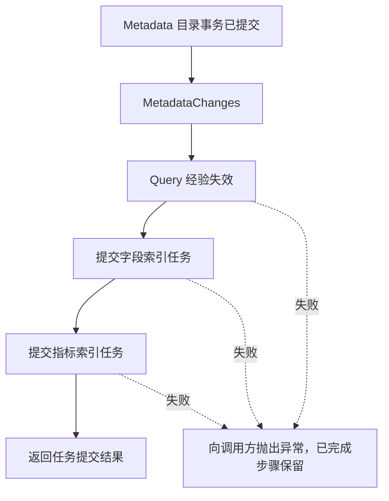
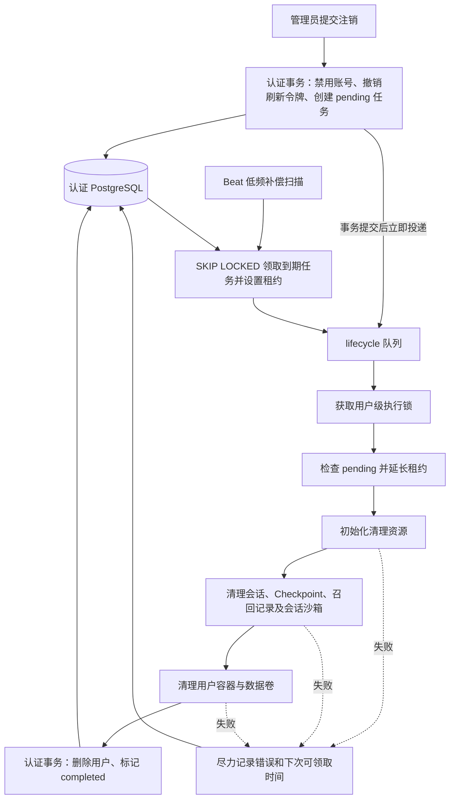

# 07. Workflows：跨模块变更与生命周期编排

Workflows 组合其他模块的公开能力，定义跨存储操作的执行顺序、提交边界和恢复策略。当前包含用户注销和元数据变更：注销以持久化任务驱动资源清理，元数据变更在目录提交后同步协调经验失效与索引投递。

工作流统一从 `app.workflows` 公开，业务调用只使用其他模块的公开出口（Identity、Metadata、Query、Sandbox、Assistant 的根包），数据契约和业务异常分别使用 `contracts`、`errors`。

## 1. 提供哪些功能

```text
Workflows：跨模块工作流
├── 注销受理（管理员请求）
│   ├── 检查目标是否为当前操作管理员
│   ├── 调用 Identity 禁用账号、撤销令牌并创建 pending 任务
│   ├── 返回是否首次受理，重复请求保留已有进度
│   ├── 事务提交后立即投递用户清理任务
│   └── 投递失败时保留已提交状态，交给到期扫描恢复
├── 注销执行（lifecycle Worker）
│   ├── 取得用户执行锁，检查 pending 状态并延长租约
│   ├── 跳过锁忙、任务缺失或已完成的重复消息
│   ├── 创建本次清理所需的会话和沙箱资源
│   ├── 调用 Assistant 清理全部会话及残留记录
│   ├── 调用 Sandbox 删除用户容器和数据卷
│   ├── 调用 Identity 删除账号并标记 completed
│   ├── 执行失败时记录原因与下次重试时间
│   └── 退出时释放清理资源和执行锁
├── 注销补偿（Beat 与调度任务）
│   ├── 批量领取已到期的 pending 任务并设置租约
│   ├── 重新投递漏投、失败或租约过期的清理任务
│   ├── 隔离单个用户的投递与失败回写错误
│   ├── 回写失败时保留租约，等待到期恢复
│   └── 返回本批次成功投递数量
├── 元数据变更协调（Metadata 提交后）
│   ├── 接收已提交的表字段失效范围和索引同步清单
│   ├── 调用 Query 失效关联查询经验
│   ├── 依次投递字段和指标语义索引任务
│   ├── 空集合跳过相应处理步骤
│   ├── 返回字段与指标任务各自的提交结果
│   └── 提交错误向上传播，保留已完成步骤供恢复
└── 工作流接入（HTTP 与 Worker 组合入口）
    ├── 提供公开的注销服务与元数据变更工作流
    ├── 通过构建函数连接查询经验失效与索引调度能力
    └── 使用各模块的公开服务、契约与资源生命周期
```

工作流调用各模块的公开服务，持久状态由业务归属模块保存。

## 2. 如何使用

### 2.1 受理注销请求

管理页面通过 `DELETE /api/v1/admin/users/{user_id}` 发起注销，要求管理员身份。HTTP 依赖取得 `UserDeletionService` 后调用：

```python
submitted = await user_deletions.request_deletion(
    user_id,
    operator_id=current_admin.id,
)
```

示例位于异步请求方法中，`user_deletions` 为已注入的 `app.workflows.UserDeletionService`。

| 方法 | 调用方与结果 |
| --- | --- |
| `request_deletion(user_id, operator_id=...)` | HTTP 入口调用，返回是否首次受理；资源清理交给 Worker |
| `process(user_id)` | 任务入口取得用户执行锁并确认 pending 状态后调用，执行资源清理 |

调用前，HTTP 入口完成管理员身份检查；传入的 `operator_id` 是当前管理员，`user_id` 是待注销用户。服务拒绝注销当前操作管理员，Identity 事务保护最后一个活跃管理员。

| 返回或异常 | 业务含义 |
| --- | --- |
| Python 返回 true | 首次受理已提交；账号禁用，刷新令牌撤销，pending 任务已创建 |
| Python 返回 false | 已有注销任务或已完成，保留原任务进度，不重复立即投递 |
| HTTP 204 | 请求已受理或此前已受理；接口不返回 Celery task_id |
| 用户不存在且没有已完成任务 | 返回用户不存在的业务异常 |
| 首次受理后的消息投递失败 | 记录日志，仍返回已受理结果，pending 记录由扫描恢复 |

服务在请求内完成认证状态事务，实际会话和沙箱清理由 Worker 执行。看到 204 后不应立即认定用户文件已删除；受理状态与完成状态需要分别确认。

构造 `UserDeletionService` 时需要 `UserDeletionStateService`、`DockerSandboxManager` 和 `ConversationLifecycleService`。Web 的依赖入口提供这些实例，Worker 在自己的资源上下文中创建它们。普通调用方使用 `request_deletion()`；`process()` 依赖任务入口已经取得用户锁并确认 pending 状态。

### 2.2 处理已提交的元数据变更

从 `app.workflows` 导入 `MetadataChangeWorkflow` 或 `build_metadata_change_workflow`。HTTP 和 Worker 的组合入口使用查询数据库管理器创建工作流，并注入 Metadata 的目录或导入服务。

```python
from app.metadata.contracts import MetadataChanges
from app.workflows import build_metadata_change_workflow

workflow = build_metadata_change_workflow(query_postgres)
# 示例：目录事务已经提交了 orders.amount 的修改。
changes = MetadataChanges(
    invalidated_columns=(("orders", "amount"),),
    sync_columns=(("orders", "amount"),),
)
tasks = await workflow.handle(changes)
```

示例位于异步业务方法中，`query_postgres` 是应用已创建的查询数据库管理器。实际变更由 Metadata 的目录或导入服务生成；工作流接收已经提交的结果。

| 输入字段 | 内容 | 作用 |
| --- | --- | --- |
| `invalidated_tables` | 表名元组 | 失效引用这些表的经验 |
| `invalidated_columns` | `(表名, 字段名)` 元组集合 | 失效引用这些字段的经验 |
| `sync_columns` | 待同步字段键 | 投递字段语义索引 |
| `sync_metrics` | 待同步指标名 | 投递指标语义索引 |

同一字段可以同时出现在失效和同步集合中：先停用依赖旧定义的经验，再建立新定义的索引。删除资产只参与失效；空集合跳过对应步骤。

| 返回字段 | 含义 |
| --- | --- |
| `MetadataChangeTasks.columns` | 字段任务的 `TaskSubmission`，未提交时为 None |
| `MetadataChangeTasks.metrics` | 指标任务的 `TaskSubmission`，未提交时为 None |
| `TaskSubmission.task_id` | 已提交任务的标识，可通过任务状态接口查询 |

`await handle()` 等待经验失效和索引投递完成，索引构建仍由 Worker 异步执行。工作流没有独立的总任务 ID，调用方分别跟踪字段与指标任务，并读取资源版本确认同步效果。

### 2.3 运行后台任务

Worker 消费 `lifecycle` 队列，Beat 负责到期注销任务扫描。两者都需运行，注销首次投递和后续补偿才能持续推进。

```bash
uv run celery --app app.shared.tasks.celery_app:celery_app worker -l INFO
uv run celery --app app.shared.tasks.celery_app:celery_app beat -l INFO
```

任务相关周期、等待和批量参数位于 `conf/app_config.yaml` 的 `lifecycle` 和 `task_queue`。

### 2.4 确认注销进度与处理失败

注销清理以 Identity 数据库中的 `UserDeletionTask` 为持久依据。当前没有独立的注销进度 HTTP 接口；管理员页面通过用户列表观察账号，排障时结合任务记录和 Worker 日志。

| 字段或结果 | 如何解释 |
| --- | --- |
| `status=pending` | 仍需推进清理，可能等待执行、正在执行或等待重试 |
| `status=completed` | 所需清理成功，认证用户已删除 |
| `attempt_count` | 失败回写累计的次数，不能直接等同于消息投递总次数 |
| `next_attempt_at` | 下次可领取时间；领取和续租期间也用作租约截止时间 |
| `last_error` | 最近记录的失败原因 |
| Worker 返回 `processed=true` | 此次消息完成了清理流程 |
| Worker 返回 `processed=false` | 因锁被占用、任务缺失或任务已完成而跳过；需结合持久状态判断 |

排障过程：

1. 确认 lifecycle Worker 和 Beat 都在运行。
2. 查看 pending 任务的 `last_error` 和 `next_attempt_at`。
3. 修复会话锁、数据库、Docker 或 Redis 对应故障。
4. 等待到期扫描重新领取并投递；重复发送注销 HTTP 请求不会重置原任务进度。
5. 确认任务变为 completed，用户及要求清理的资源已移除。

清理某一步成功后，后续步骤仍可能失败。重试从流程入口重新执行，由各模块处理已不存在的资源；账号在 pending 期间持续禁用。

### 2.5 恢复部分完成的元数据变更

元数据变更工作流没有自己的持久任务表，恢复依据是目录当前值、经验状态、资源索引版本及已知任务结果。

| 失败位置 | 先确认什么 | 恢复动作 |
| --- | --- | --- |
| 经验失效事务失败 | 目录已提交的变更范围，经验是否仍 active | 重新处理已提交变更，完成经验失效后再同步索引 |
| 经验索引消息投递失败 | 经验状态已失效，revision 是否落后于索引 | Query 的修复扫描补投经验索引，Metadata 后续步骤仍可继续 |
| 字段索引投递失败 | 经验已失效，字段任务是否确实入队 | 在完成经验失效的前提下重投字段及尚未提交的指标同步 |
| 指标索引投递失败 | 字段任务可能已入队 | 保留并跟踪字段任务，补投指标同步 |
| Worker 索引执行失败 | 源目录版本、ES 和 Embedding 错误 | 修复设施后重试对应资源同步 |

Query 的经验索引调度器记录投递失败并返回 false，数据库经验状态保留；Metadata 的字段和指标调度器会向工作流抛出提交错误。两类失败对后续步骤的影响不同。

通过业务入口重新处理 `MetadataChanges` 时，必须使用真实已提交的变更范围。仅重新保存一份内容未变的目录，可能不会再产生相同变更通知；管理页的手动同步适合补索引，经验失效仍需由对应服务完成。

## 3. 关键业务规则

### 3.1 注销状态与幂等

任务只有两种持久状态：

| 状态 | 含义 |
| --- | --- |
| `pending` | 等待执行、已投递、执行中或等待重试 |
| `completed` | 所需资源清理成功，认证用户已删除 |

| 操作或情况 | 状态处理 |
| --- | --- |
| 首次受理 | 在同一认证事务内禁用账号、撤销刷新令牌并插入任务，保护最后一个活跃管理员 |
| 重复受理 | 保留已有租约、失败信息和重试时间；插入冲突使用 `DO NOTHING` |
| 领取 pending 任务 | 将 `next_attempt_at` 推迟到租约截止时间 |
| Worker 开始执行 | 再次延长领取租约 |
| 部分资源已删除 | 可以从头重试，由会话和沙箱模块处理重复删除 |
| 清理全部成功 | 在同一认证事务内删除用户并标记 completed |
| 重复完成或迟到失败 | 保持 completed 终态 |

租约控制重新调度，用户级执行锁防止并行清理。

### 3.2 清理范围与完成条件

| 资源 | 用户注销时的处理 |
| --- | --- |
| 平台用户与 Refresh Token | 受理时禁用/撤销，清理成功后完成身份删除 |
| Conversation、Checkpoint、召回记录 | 调用 Assistant 清理全部会话及遗留记录 |
| 用户容器、卷及文件 | 调用 Sandbox 删除，用户删除标记保留 |
| 用户注销任务 | 完成后保持 completed，不被迟到失败覆盖 |
| 角色共享查询账号与权限 | 保留，不因一个平台用户注销而删除共享角色 |
| 查询经验与原始执行记录 | 不由此注销流程清除 |

完成条件是所有要求清理的外部资源操作成功后，认证事务删除用户并标记 completed。不存在覆盖 PostgreSQL、Docker 和 Redis 的统一事务；部分删除成功后再次运行，所属模块按资源已经不存在的情况继续完成。

### 3.3 元数据提交后顺序

管理员修改或导入元数据后，目录事务先提交，再把本次变更交给 `MetadataChangeWorkflow`。工作流只接收变更结果，不重新执行目录写入。

处理顺序：

1. 失效受影响的旧查询经验，使其排除在重新检索的结果之外。
2. 投递字段语义索引任务。
3. 投递指标语义索引任务。

Worker 按版本异步建立新索引。字段取值同步使用独立的全量和增量入口。

PostgreSQL、Elasticsearch 和消息队列分阶段生效：

| 失败阶段 | 已完成或保留的工作 |
| --- | --- |
| 经验失效失败 | 目录已提交，后续索引任务不再投递 |
| 字段索引投递失败 | 目录和经验失效已提交 |
| 指标索引投递失败 | 字段索引任务可能已入队 |

错误向调用方抛出。排查时先确认目录当前值，再查看经验和索引状态，补做未完成步骤。

### 3.4 部分完成的恢复依据

| 变更字段 | 含义 | 后续动作 |
| --- | --- | --- |
| invalidated_tables | 已更新或删除的表资产 | 禁用依赖这些资产的经验 |
| invalidated_columns | 已更新或删除的字段资产 | 禁用依赖这些资产的经验 |
| sync_columns | 需要同步的字段目录 | 提交字段语义索引任务 |
| sync_metrics | 需要同步的指标目录 | 提交指标语义索引任务 |

删除资产只参与失效，不作为新索引资源重新提交。返回的 MetadataChangeTasks 保存字段和指标任务提交结果，便于接口返回任务标识。



该工作流没有独立持久化任务表，也没有自动回滚整个目录变更的机制。经验失效失败时不投递后续索引；指标任务投递失败时字段任务可能已经入队。恢复依据是目录版本、经验状态、索引版本和队列结果。

## 4. 内部实现

### 4.1 目录与流程归属

```text
workflows/
├── __init__.py          跨模块公开入口
├── metadata_changes.py 元数据变更工作流及其装配函数
├── user_deletion.py    用户注销受理与清理编排
├── task_scheduler.py   注销任务提交
└── tasks.py            执行锁、领取续租、资源管理和补偿扫描
```

| 工作流 | 输入 | 执行方式 | 状态归属 |
| --- | --- | --- | --- |
| 用户注销 | 用户 ID、操作管理员身份 | API 受理后投递 lifecycle，Worker 执行，Beat 补偿 | Identity 的 UserDeletionTask |
| 元数据变更 | 已提交的 MetadataChanges | 调用方等待经验失效和索引提交，索引工作异步执行 | Metadata 目录/索引版本与 Query 经验状态 |

| 组件 | 职责 |
| --- | --- |
| UserDeletionService | 受理后的立即投递与清理顺序 |
| MetadataChangeWorkflow | 先失效旧经验，再提交字段及指标索引 |
| 任务执行入口 | 用户互斥、租约检查、资源创建与失败记录 |
| 到期调度入口 | 原子领取、逐条投递及批次错误隔离 |
| `build_metadata_change_workflow` | 与元数据变更实现放在同一文件，为 HTTP 和 Worker 创建处理能力 |
| Task Scheduler | 提交消息并提供业务调用方所需的任务标识 |

工作流只协调顺序；各模块保留自己的验证、存储和幂等规则。持久化记录放在业务归属模块，不能把调用栈本身当作可靠进度。

### 4.2 注销执行流程



| 触发或状态 | 行为 |
| --- | --- |
| 首次受理提交成功 | 在线程中立即投递 Celery，避免阻塞 API 事件循环 |
| 管理员接口返回 | 表示已受理，清理进度由后台任务推进 |
| 投递失败 | 保留 pending 记录，由补偿扫描恢复 |
| 重复受理 | 不重复投递 |
| 账号禁用 | 拒绝后续认证，其他进程已运行的 Agent 仍需各自的取消机制处理 |
| 会话生命周期锁忙 | 清理失败，等待重试 |

### 4.3 锁、事务和资源

| 组件 | 职责 |
| --- | --- |
| `UserDeletionService.request_deletion()` | 禁止注销当前操作管理员，提交注销事务后立即投递 |
| `app.identity.UserDeletionStateService` | 注销受理、执行锁、领取/续租、失败及完成的数据库事务 |
| `IdentityPGRepo` | 注销记录的查询和更新，不负责消息投递 |
| `_dispatch_due_user_deletions()` | 批量领取并逐个投递，隔离每个用户的投递/回写错误 |
| `_process_user_deletion()` | 持锁校验任务，管理资源生命周期，统一记录执行失败 |
| `UserDeletionService.process()` | 在入口保护下依次清理会话、用户沙箱并完成认证状态 |

Worker 先创建认证库管理器，获取用户级非阻塞 advisory lock。未获得锁、任务缺失或已经完成时直接跳过，不初始化 LangGraph 或沙箱。

| 事务范围 | 生命周期 |
| --- | --- |
| 用户执行锁 | 独立认证事务，清理期间占用一条连接；事务退出或连接断开时释放 |
| 注销受理 | 独立短事务 |
| 租约续期 | 独立短事务 |
| 失败回写 | 独立短事务 |
| 完成状态 | 独立短事务 |

取得执行锁后再次检查任务状态，确认可以开始删除资源。

清理资源使用上下文管理器释放，失败回写在已取得的用户锁释放前执行。进程被强制终止、取消或数据库不可用时可能无法记录失败，后续依靠领取租约到期恢复。

### 4.4 领取、续租与补偿

| 配置/常量 | 默认值 | 含义 |
| --- | --- | --- |
| `lifecycle.user_deletion_schedule_seconds` | 300 秒 | Beat 对漏投、失败和租约到期任务进行补偿扫描的周期 |
| `lifecycle.user_deletion_retry_seconds` | 60 秒 | 执行/投递失败后到下一次可领取的最短等待时间 |
| `lifecycle.cleanup_batch_size` | 100 | 每次领取任务数量上限 |
| `USER_DELETION_CLAIM_SECONDS` | 3900 秒 | 数据库领取租约，按任务硬时限加 300 秒计算 |
| `task_queue.task_time_limit_seconds` | 3600 秒 | Celery 单任务硬时间上限 |

首次清理以立即投递为主。注销任务不启用 Celery 自动重试；失败重试和漏投恢复统一由数据库到期任务扫描驱动。Broker 消息重投仍可能发生，由任务入口的用户锁和终态检查保护。pending 任务持续按到期时间重新调度，直至成功完成。

| 调度场景 | 等待过程 |
| --- | --- |
| 正常首次投递 | 等待队列调度 |
| 失败后重试 | 最短等待结束后，等待下一轮补偿扫描和队列调度 |

领取租约控制数据库任务再次领取，Redis 消息可见性控制 Broker 重投；两者当前数值相同，职责分别维护。

投递某个用户失败时尽力记录重试时间；回写再次失败则保留原租约，继续处理批次中的其他用户。执行失败同样保留原始异常，不让记录异常替代清理根因。

## 5. 异常与排障

| 现象 | 检查与处理 |
| --- | --- |
| 注销接口已返回，资源仍存在 | UserDeletionTask 是否 pending、任务是否入队、Worker 是否消费 lifecycle |
| 注销重复投递 | 查看领取租约和用户执行锁，确认是否同一任务的恢复投递 |
| 注销失败后没有立即重试 | next_attempt_at、补偿扫描周期和队列等待时间 |
| 清理期间账号一直禁用 | pending 状态会保持禁用，先处理最后错误再等待重试 |
| 清理锁忙 | 当前会话或用户是否有其他执行，等待其退出后重试 |
| 元数据接口失败但目录已变化 | 目录已提交，按经验失效和索引投递阶段确认剩余工作 |
| 字段索引有任务、指标索引没有 | 检查第二阶段投递错误，已入队任务按各自状态继续 |
| 写失败记录也报错 | 保留原执行异常，待现有租约到期后由扫描恢复 |

注销以 Identity 中的任务状态为准，元数据变更以目录版本、经验状态和索引版本为准。修复故障后补做未完成阶段，已完成的外部操作按各模块幂等规则处理。
